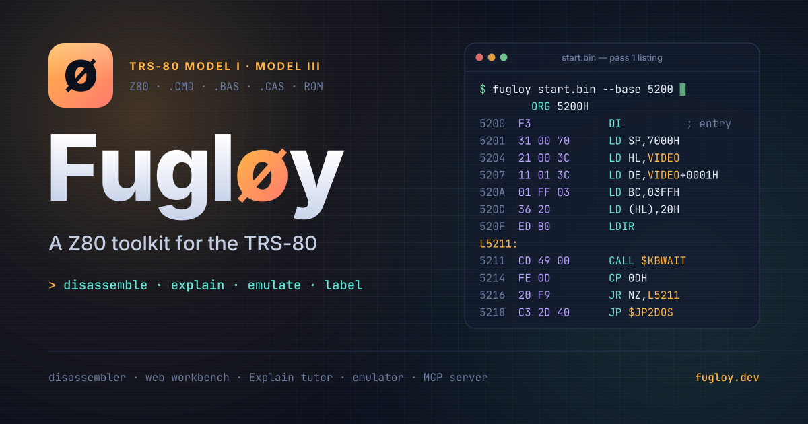

<p align="center">
  <a href="docs/images/og-image.png"></a>
</p>

# Fugløy

[](https://github.com/cschweda/fugloy/actions/workflows/ci.yml)
[](https://github.com/cschweda/fugloy/actions/workflows/exerciser.yml)
[](https://github.com/cschweda/fugloy/releases)
[](LICENSE)
[](#what-is-it)
[](https://github.com/gp48k/zmac)
[](https://nodejs.org)
[](https://www.typescriptlang.org)

**A toolkit for taking apart TRS-80 Model I and Model III programs: a
disassembler that proves its output rebuilds the original byte for byte, a
workbench in the browser that explains every line, and a headless emulator
with a debugger whose runs feed back into the listing.**

## What is it?

Fugløy started as a disassembler and has grown into a reverse-engineering
toolkit for the TRS-80, built to read old programs faithfully and keep what
you learn about them. It reads a program the way the machine stored it, a
`.CMD` load module or a tokenized BASIC program, works out which bytes are
code, names what it can, and gives back source that reassembles to the same
bytes. Around that core sit a web workbench for reading and annotating
listings, an emulator that runs the program and records what really executed,
and an MCP server that lets an AI assistant drive the emulator.

| Part | What it does | Status | Where |
| --- | --- | --- | --- |
| **Disassembler** | Loads `.CMD`, `.BAS`, and raw files by content; recursive descent; labels; cited ROM, hardware, and DOS names; hint files; hidden code in BASIC; rebasing and relocation; zmac source that reassembles byte for byte; JSON IR; reads the emulator's label files | Released, 1.2.0 on npm | `@fugloy/disasm`, the `fugloy` command in `@fugloy/cli`, opcode tables in `@fugloy/z80` |
| **Web workbench** | The disassembler in the browser: facing pages, the four public-domain games one click away, editing by keyboard, the **Explain** tab, block comments, exports | Live | [app.fugloy.dev](https://app.fugloy.dev/), source in `apps/web` |
| **Emulator** | A headless, deterministic Model III and Model I that passes ZEXDOC and ZEXALL, runs `.CMD`, `.BAS`, and `.CAS` programs and disk images, and has a debugger that writes label and coverage files | 0.4.0 on npm (2026-10-18; the Model 4, emu phase 6b), after 0.3.0 (disks and the Model I, phases 5–7) | `packages/emu` (`@fugloy/emu`) |
| **MCP server** | Lets an AI assistant such as Claude Code load a program, run it, set breakpoints and watches, read the screen, and name what it finds in the same label file | 0.1.1 on npm (2026-10-18), MCP phases A–F; disk images and the Model I; 0.1.2 (the Model 4) also published 2026-10-18 | `packages/mcp` (`@fugloy/mcp`) |
| **Ahead** | An assembler and IDE in the workbench, a course in assembly for non-programmers, and, later, recompiling games to TypeScript | Planned | [Roadmap](#whats-ahead) |

Its core libraries have no runtime dependencies and use no Node or browser
APIs, so the same code runs in the command line, the browser, and the tests.

Named after the island in *Voyage of the Valkyrie*; spelled `fugloy` in code.

### The disassembler

Give it a program for the Model I or Model III and it turns it into:

- a **listing** that separates code from data, names every jump, call, and
  data reference, names the ROM, hardware, and DOS addresses a program uses
  from eight cited tables of 634 entries, and shows machine code hidden in
  BASIC at the address it really occupies;
- **zmac assembler source** that assembles back into exactly the same bytes;
- a **JSON description** of the program (regions, basic blocks,
  cross-references, symbols) for other tools to build on.

Your names, comments, and code and data decisions live in a plain-text
[hint file](#hint-files), and a [label file](#label-files) from the emulator
turns the code a run reached into code in the listing. It is a command-line
tool for Node 22, published on npm as `@fugloy/cli`; see [Install](#install)
and [Use](#use).

### The web workbench

[app.fugloy.dev](https://app.fugloy.dev/) runs the same disassembler
in the browser, with nothing to install and no server. Open a program of your
own or one of the four public-domain Westmoreland and Gilman games, and the
listing appears on the left of two facing pages, beside tabs for symbols, an
index, a spec sheet of the program, and manuals. You name, comment, and mark
code or data from the keyboard, and each edit lands as a line in the hint
file. Work saves in your browser, backs up and restores between browsers, and
exports as zmac
source, hints, IR, a `.CMD` load module, or a `.CAS` tape. Bring your own
copies of the cited manuals and a citation opens at its page.

The **Explain** tab is a tutor for every machine-code line: what it does in
plain English, from register values proven on every path to it and never
from a guess; the patterns it belongs to, such as block copies, delay loops,
and a loader moving the program to where it runs; a summary of the routine
around it; and, for data, the code that reads it and a picture of its bytes
in the TRS-80 character set, block graphics included. Each code line also
says why it is there: why the Z80 makes it use the register it does, what it
does for the program (a value followed to the screen cell, port, or loop it
feeds, only as far as the flow is proven), and why a programmer would write
it that way, with the byte and T-state costs of the alternative taken from
the opcode table. Block comments (the
hint file's `note`, the **:** key) sit above any line. The workbench opens
Sea Dragon already annotated, from
[`seadrg01.hints`](examples/sea-dragon/seadrg01.hints).

### The emulator

`@fugloy/emu` is a headless TRS-80 Model III, and (since emu 0.3.0, phase 6) a
Model I with its Expansion Interface, and (since emu 0.4.0, phase 6b) a Model 4,
in Model III mode and with its native hardware, in plain JavaScript, built on the
core of [trs80-emulator](https://github.com/cschweda/trs80-emulator). It has
no DOM and no Node APIs, and the same inputs give the same run every time, so
a scripted session repeats byte for byte. Its Z80 core passes ZEXDOC and
ZEXALL. It loads `.CMD`, `.BAS`, and `.CAS` programs, takes keys on a
cycle-timed queue, reports sound as events and the screen as text, and Sea
Dragon, Eliminator, and Rear Guard reach their title screens on it, on both
models. Its
debugger, `m.debug`, has breakpoints, watches, hooks, coverage, callers, a
trace, and snapshots, and writes the [label and coverage
file](docs/label-format.md) that the disassembler reads with `--labels`. You
bring the ROM. Usage is in its [README](packages/emu/README.md).

### The MCP server

`@fugloy/mcp` is a stdio MCP server over the emulator, built as the
emulator's phase 4. An assistant such as Claude Code gets 29 tools: load a
program and boot the ROM, run it (for a number of cycles or seconds, to a
breakpoint, or until the screen settles), step, type keys, read registers,
memory, and the screen, disassemble with coverage marks, set breakpoints with
conditions and memory watches, see which routine made each write, list a
routine's callers and callees, snapshot the machine and diff memory against
a snapshot, search memory for bytes or text, and keep labels in a
`<program>.fugloy.json` beside the program, the label and coverage file the
disassembler reads with `--labels`. `suggest` lists the routines worth
naming next, with what each was seen doing (writing video RAM, reading the
keyboard, making sound, looping). Prompts (`orient`, `find-writer`,
`label-pass`, `explain`) carry the method, and resources give the screen,
the labels, and the Model III ROM's symbols.

Given only "load Sea Dragon and find the routine that writes text to the
screen; label it", a headless Claude Code session watched the screen, ran
the title, followed the writes to the routine at `$6140`, read its code and
callers, and labelled it `PRINT_TEXT` with a correct note, in 15 turns. Given
the `label-pass` prompt ("play for a minute, then label what you can
justify"), it labelled three public-domain games on its own: 18 routines
in Sea Dragon (twelve of them routines the hand-made hint file names, with
the same meaning), all 17 that `suggest` listed in Eliminator, and all 24 in
Rear Guard, each with a note saying how it knew.

Install it with `npx -y @fugloy/mcp` as an MCP server
(or run `node packages/mcp/bin/fugloy-mcp.js` from a clone, for development), with a
`fugloy.mcp.json` that names your Model III ROM (and your Model I ROM, for `load` with `model: 1`, and your Model 4 ROM, for `model: 4`, since mcp 0.1.2); the setup (from npm or from
a clone), the tools, and those sessions are in its
[README](packages/mcp/README.md), and the design is in
[docs/fugloy-mcp-spec.md](docs/fugloy-mcp-spec.md).

### What's ahead

From the roadmap in [CLAUDE.md](CLAUDE.md) and the
[project plan](docs/Fugloy-Project-Plan.md):

- **The emulator's later phases:** the Model 4's native DOS (emu phase 6b
  built the Model 4's hardware and Model III mode; an LS-DOS 6 or TRSDOS 6
  boot waits for a disk), and a Model I differential reference. Disk images
  (phase 5) and the Model I (phase 6) are released in `@fugloy/emu` 0.3.0.
- **An assembler and IDE** (plan phase 5): write Z80 assembly in the
  workbench, assemble it to a `.CMD`, and run it on an emulated Model I or
  Model III beside its listing, an IDE in the way Inform 7 has one for its
  language.
- **Learn assembly with Fugløy** (phase 6): an introduction to assembly for
  people who have never programmed, on the small and regular Z80, with
  Explain's tutor voice on each line written and a tutorial that builds a
  Space Invaders-style game from a blank page.
- **Recompilation** (the plan's Part 2): turning a game into readable
  TypeScript that plays the same in a browser, checked frame by frame against
  the emulator, and bundling the public-domain games for one arcade page.
  Part 2 is outlined, not designed; it gets its own design document, and the
  plan's kill criteria are reviewed before it starts.

## Why Fugløy

The disassembler is the part the rest builds on, and it is where Fugløy
differs most from the tools that came before it.

### How the usual tools work

**Emulators** run the program on a simulated TRS-80, and their debuggers let
you watch it execute, instruction by instruction. That is the best way to see
what a program does, and it covers the code that a particular run reaches. The
debugger's view is live memory, not a listing you can edit, keep, and rebuild.
trs80gp can also record a run as a disassembly (Record → Bus Use); its manual
says the result should be a good one once the program has been put through its
paces, and that a program that relocates itself needs a relocated copy loaded
first.

**General-purpose disassemblers** start from a raw memory dump. You tell them
where the code begins and they decode forward from there, so text, tables,
and graphics come out as nonsense instructions until you mark them by hand.
The large interactive suites follow jumps and calls instead. Either way they
are built for any Z80 system, and the TRS-80's habits are left to you:

- a `.CMD` file is a list of load records, not a memory image, and real
  files bend the format's rules;
- tokenized BASIC stores each keyword as a single byte, and games hid machine
  code inside BASIC lines so that one load brought in both;
- many games load high in memory and copy themselves elsewhere before they
  run, so the code you want is never where the file put it.

**TRS-80 disassemblers** read `.CMD` files directly. MISOSYS's DSMBLR (1983)
ran on the TRS-80 itself, and DASM80 and Z80Disasm are command-line programs
for Windows; each takes "screening" files that mark address ranges as data.
None of the three documents reading tokenized BASIC.

Nothing in that workflow checks that the listing, assembled again, gives back
the bytes it came from.

### What Fugløy does differently

- **It reads the machine's own formats.** `.CMD` load records, quirks
  included, and tokenized Level II BASIC are recognized by their content,
  never by the file's extension, and the bytes land in a 64K image exactly
  where the TRS-80 would put them.
- **It finds code hidden in BASIC.** Every line is parsed as BASIC, statement
  by statement; a line that cannot be BASIC is machine code, disassembled at
  its true address. Fugløy also follows the program's own `PEEK` and `POKE`
  arithmetic to the entry point the BASIC text plants. On all 13 *Voyage of
  the Valkyrie* files it finds exactly the 182 code lines and the entry that
  line 250 builds.
- **It follows the flow.** Recursive descent from the program's real entry
  points keeps data out of the instruction stream. Text becomes quoted
  strings, and jump tables and self-moving loaders are proposed with the
  exact hint lines that would declare them, never applied behind your back.
- **It analyzes code where it runs.** A `relocate` hint says that some bytes
  execute at another address. Fugløy analyzes them there and emits them
  inside zmac's `.PHASE`, so the source still rebuilds the file. Asylum's 123
  loader records become 123 such hints, generated from the game itself, and
  61% of the game then decodes at its running address.
- **It names the machine's own addresses.** ROM routines, hardware registers
  and ports, and DOS vectors and service calls come out by name, from eight
  tables of 634 entries, each entry citing a page of a published source. The
  Model I and Model III ROM maps are entered separately and compared, and a
  name the other machine's map does not confirm says which machine it came
  from. `--machine` and `--dos` choose the tables.
- **It proves its output.** The tests assemble Fugløy's source with a pinned
  zmac and compare every byte: every Z80 encoding, every synthetic fixture,
  83 real programs, and the Model I Level II ROM.
- **It keeps your notes.** Names, comments, and code and data decisions live
  in a plain-text hint file keyed by content, so one file fits a relocated
  build of the same program, and a BASIC program after `--rebase`.
- **It learns from a run.** The emulator in `packages/emu` writes a label and
  coverage file of what a session executed, read, and wrote; `--labels` feeds
  it back, so code that only a run reaches becomes code in the listing. A file
  written for a different program is refused, and the hint file wins where
  both speak.
- **It lets an assistant do the legwork.** The [MCP server](#the-mcp-server)
  hands the emulator to an AI assistant, which can run a program, watch it,
  find a routine by what it writes, and record what it learns in the same
  label file.

## User stories

What people come to Fugløy for, and how each one is done today.

- **As a fan who grew up with a TRS-80 game,** I want to read its machine
  code as labeled assembly, so that I can see how it really worked.
  *Today:* `fugloy game.cmd` lists it, with the jumps, calls, and data
  references inside the program named.
- **As a reader of a listing,** I want ROM and DOS calls named, so that
  `CALL 0033H` reads as showing a character. *Today:* it lists as
  `CALL $VDCHAR`, with what the routine does beside it, for the machine and DOS
  you pick with `--machine` and `--dos`.
- **As someone studying a BASIC game,** I want the machine code hidden in its
  lines shown at the addresses it occupies, so that I can follow what the
  BASIC hands off to. *Today:* `fugloy game.bas` parses every line,
  disassembles the ones that cannot be BASIC, and finds the entry point the
  BASIC plants when it uses one of the common idioms.
- **As a preservationist,** I want a disassembly I can trust byte for byte,
  so that an annotated or repaired copy can be rebuilt exactly. *Today:*
  `--format zmac` writes source that the test suite reassembles and compares
  with the original, for every fixture and every sample program present.
- **As a reverse engineer working over many evenings,** I want my names,
  comments, and code-or-data decisions kept in a file I can commit, so that
  nothing I learn is lost and the same notes fit other builds of the program.
  *Today:* hint files are plain text keyed by content; one file fits Asylum
  1b, 1c, and 1d.
- **As someone taking apart a game that moves itself,** I want its code
  analyzed at the addresses where it runs, so that the listing matches what
  the CPU executes. *Today:* `relocate` hints, and proposals with the exact
  hint lines for the common copy-then-jump loaders.
- **As a modder,** I want to change the assembly and rebuild the program, so
  that I can fix a bug or make a variant. *Today:* the zmac source
  reassembles as it stands, labels and relocated regions included, so your
  edits start from a faithful copy.
- **As a tool builder,** I want the analysis as data, so that I can build my
  own views on it. *Today:* `--format ir` writes JSON with regions, basic
  blocks, cross-references, symbols, proposals, and relocations, and the core
  library is written to run in a browser.
- **As a teacher,** I want real examples of how 1980 software fit BASIC and
  machine code into 48K, so that students can see the tricks for themselves.
  *Today:* the listings show tokenized BASIC, hidden code, and self-moving
  loaders next to the bytes they came from.
- **As someone checking what really runs,** I want to run the program and see
  which bytes execute, so that the listing can be confirmed against the real
  thing. *Today:* the headless emulator in `packages/emu` runs it and writes a
  label and coverage file, and `--labels` applies that file to the listing.
- **As someone without a terminal,** I want to explore and annotate a listing
  in the browser. *Today:* the web workbench at
  [app.fugloy.dev](https://app.fugloy.dev/).

- **As someone working with an AI assistant,** I want it to run the program,
  set breakpoints, and read the screen for me, so that it can find and name
  routines as I would. *Today:* the MCP server (`npx -y @fugloy/mcp`, or
  `node packages/mcp/bin/fugloy-mcp.js` from a clone);
  Claude Code found and labelled Sea Dragon's print routine with it unaided,
  and labelled 18 to 24 routines in each of Sea Dragon, Eliminator, and Rear
  Guard from the `label-pass` prompt.

Planned, per the roadmap:

- **As someone learning assembly,** I want to write Z80 code and run it at
  once. *Planned:* phase 5's assembler and IDE in the workbench.

## Status

**Current release: [1.2.0](https://github.com/cschweda/fugloy/releases/tag/v1.2.0)**
(2026-10-18), published to npm as `@fugloy/z80`, `@fugloy/disasm`,
and `@fugloy/cli`, which share one version. It follows 1.1.0 (the first on npm, which added `--labels`, reading
the emulator's label and coverage file) and
[v1.0.0](https://github.com/cschweda/fugloy/releases/tag/v1.0.0), v1: phases
1–4 of the plan. Phase 3 names ROM, hardware, and DOS addresses from cited
symbol tables, with `--machine` and `--dos` choosing them. Phase 4 is the web workbench, live at
[app.fugloy.dev](https://app.fugloy.dev/): open a program or one of the
four public-domain games, read and annotate the listing, click any line for a
plain-English explanation in the Explain tab, write block comments, save in
your browser, and export zmac source, hints, IR, `.CMD`, or `.CAS`. Earlier
releases: phase 2, Pass 1 and Pass 2, as
[v0.2.0](https://github.com/cschweda/fugloy/releases/tag/v0.2.0); phase 1, the
core decoder and loaders, as
[v0.1.0](https://github.com/cschweda/fugloy/releases/tag/v0.1.0).

The emulator, `@fugloy/emu` 0.4.0 (on npm since 2026-10-18, with the Model 4), has all eight
of its phases built, the Model 4 and the Model I's differential run aside:
the core of [trs80-emulator](https://github.com/cschweda/trs80-emulator)
booting the Model III ROM to `READY` in Node (0); a Z80 core that passes
ZEXDOC and ZEXALL (1); the Model III as a `Machine`, with video, sound,
keyboard, and `.CMD`, `.BAS`, and `.CAS` loaders, on which Sea Dragon,
Eliminator, and Rear Guard reach their title screens (2); the debugger,
`m.debug`, with breakpoints, watches, coverage, a trace, snapshots, and the
label and coverage file (3); the MCP server, `@fugloy/mcp` 0.1.1 (4), whose
phases A–F are done, from the tools through snapshots and diffs, resources
and prompts, and the npm release; disk images (5): the WD1793 controller,
JV1, JV3, and DMK images, and MCP `load` booting a disk, on which
Eliminator, Rear Guard, and Scarfman load from their disks to their titles;
the Model I (6): its Level II ROM, 4–48K, the Expansion Interface's 40 Hz
clock, WD1771 disk controller, and printer, the video without bit 6 (and the
lowercase modification), 500-baud cassette, and the keyboard, on which
fourteen programs reach their titles and four disks boot, with MCP `load`
taking `model: 1`; and a differential harness against trsjs (7), with no
unexplained divergence in six game sessions on the Model III. The Model 4
(6b) is published in emu 0.4.0 and mcp 0.1.2 (2026-10-18): on the Model 4 ROM
it boots to Model III BASIC's `READY`, where Model III programs and disks run
(Sea Dragon matches the Model III screen for screen and T-state for T-state
from `READY`; the two ROMs differ in 727 bytes), and its native hardware (four
memory maps, 128K banking, 80 by 24 video, the 4 MHz clock, with the timer's
60 Hz at 4 MHz following xtrs, unverified) runs synthetic programs;
coverage is kept per memory map and page, and MCP `load` takes `model: 4`. A
version 6 DOS booting waits for an LS-DOS 6 or TRSDOS 6 disk (see the
roadmap in [CLAUDE.md](CLAUDE.md)). Later,
phase 5 adds an assembler with an IDE in the workbench: write Z80 code,
assemble it, and run it on an emulated Model I or Model III. Every change is
recorded in [CHANGELOG.md](CHANGELOG.md); core releases are tagged `vX.Y.Z`
on `main`, the emulator's `emu-vX.Y.Z`, and the MCP server's `mcp-vX.Y.Z`.

| Package | What it holds |
| --- | --- |
| `packages/z80` | Z80 opcode tables generated from the x/y/z/p/q decomposition (unprefixed, `CB`, `ED`, `DD`/`FD`, `DDCB`/`FDCB`) with length, operands, cycle counts, and control-flow effect; a decoder; an exhaustion test against an independently typed reference. No I/O. |
| `packages/disasm` | 64K memory image with a load bitmap and block log, `.CMD` and `.BAS` loaders, content-based format detection, raw loader, a Level II BASIC parser and entry-point miner, pass 1 recursive descent, labels, the hint file, string and proposal heuristics, rebasing, relocation, the cited symbol tables (`data/symbols`, compiled by `pnpm symbols`), zmac emitter, JSON IR, linear sweep, plain-text listings. No Node or DOM APIs, so it runs in a browser. |
| `packages/cli` | `fugloy <file> [--base <hex> \| --rebase <hex>] [--entry <hex>]... [--hints <path> \| --write-hints <path>] [--labels <path>] [--machine 1\|3\|4] [--dos trsdos\|ldos\|none] [--format listing\|zmac\|ir] [--sweep] [--color] [-o <path>]`, the only package that touches the file system. |
| `packages/emu` | The headless, deterministic TRS-80 Model I, Model III, and Model 4 emulator, built on the core of trs80-emulator: a Z80 CPU that passes ZEXALL, the `Machine` facade (`step`, `run`, registers, memory, video text, sound events, keyboard), `.CMD`, `.BAS`, and `.CAS` loaders with manifests, and the debugger `m.debug`, which writes the label and coverage file. No DOM, no Node APIs. Design in [docs/fugloy-emu-spec.md](docs/fugloy-emu-spec.md); usage in its [README](packages/emu/README.md). |
| `packages/mcp` | The stdio MCP server that lets an AI assistant drive the emulator (`bin/fugloy-mcp.js`, plain JavaScript): MCP phases A–F, 29 tools for loading, running, typing, inspecting, breakpoints and watches, callers and callees, a disassembly with coverage marks, snapshots and diffs, search, labels, coverage, and `suggest`, with the `<program>.fugloy.json` sidecar, plus resources and prompts. Design in [docs/fugloy-mcp-spec.md](docs/fugloy-mcp-spec.md); setup in its [README](packages/mcp/README.md). |
| `apps/web` | The web workbench (`@fugloy/web`, Nuxt 4 and Nuxt UI, static, deployed to Netlify), running the disassembler in the browser. |
| `fixtures/synthetic` | Generated fixtures, one `.CMD` or `.BAS` per loader rule and analysis case plus their hint files, written by the test suite's own `.CMD` writer and BASIC tokenizer. |
| `fixtures/hints` | Hint files for real programs; `asylum16.hints` carries Asylum's generated relocate lines, and `volcano.hints` relocates Volcano Hunter's game to its runtime address. |

The workbench is live at [app.fugloy.dev](https://app.fugloy.dev/); `fugloy.dev` and
`www.fugloy.dev` redirect to it.

## Install

The command-line tool needs Node 22 or later. Run it without installing, or
install it once to get the `fugloy` command:

```sh
npx @fugloy/cli GAME.CMD     # run once
npm i -g @fugloy/cli         # or install it
fugloy GAME.CMD --format zmac -o game.z
```

The libraries are `@fugloy/disasm` (loaders, analysis, emitters; runs in a
browser) and `@fugloy/z80` (the opcode table and decoder). The examples below
use `pnpm fugloy` from a clone, which runs the same CLI; with the package
installed, write `fugloy` instead. The emulator and the MCP server are on npm too: `npm i @fugloy/emu` (its
[README](packages/emu/README.md) shows the API) and `npx -y @fugloy/mcp` (its
[README](packages/mcp/README.md) shows the Claude Code setup); for
development, use them from a clone (`pnpm install && pnpm build`, then
`node packages/mcp/bin/fugloy-mcp.js`). The workbench needs no install.

## Requirements

To build from source: Node 22 (`.nvmrc`) and pnpm 10. The round-trip tests also need zmac, which
`pnpm zmac:install` builds from a pinned commit into the gitignored `tools/`
folder; that takes git, make, a C compiler, and bison. Without zmac those
tests skip; with `FUGLOY_REQUIRE_ZMAC=1`, as in CI, they fail instead.

## Use

```sh
pnpm install
pnpm test          # vitest, all packages
pnpm typecheck     # tsc project references plus the test sources
pnpm build         # emits dist for z80, disasm, and cli (run it before pnpm fugloy)
pnpm fixtures      # regenerates fixtures/synthetic from the writers
pnpm symbols       # validates data/symbols/*.json, regenerates the tables module and COMPARISON.md
pnpm zmac:install  # builds the pinned zmac into tools/ for the round-trip tests
pnpm zex:install   # downloads ZEXDOC and ZEXALL into tools/zex/ for the emulator's exerciser tests
pnpm web:dev       # the workbench on a local dev server; pnpm test:web runs its tests

pnpm fugloy path/to/program.cmd          # load module: pass 1 listing (descent from the entry)
pnpm fugloy path/to/program.bas          # tokenized BASIC: its lines, any hidden code disassembled
pnpm fugloy program.bas --rebase 7000    # the same program as if saved from $7000
pnpm fugloy path/to/code.bin --base 5200 # raw binary at a base address (hex)

pnpm fugloy game.cmd --entry 7000 --entry 7A40   # extra entry points for pass 1
pnpm fugloy game.cmd --machine 1                 # Model I names (the default is 3); --dos trsdos|ldos|none picks the DOS's
pnpm fugloy game.cmd --format zmac -o game.z     # assembler source that reassembles to the same image
pnpm fugloy game.cmd --format ir                 # JSON: regions, blocks, xrefs, symbols, proposals, relocations
pnpm fugloy game.cmd --sweep                     # the phase-1 linear sweep instead of pass 1
pnpm fugloy game.cmd --color                     # the listing in color on a terminal (plain when piped or with NO_COLOR)
pnpm fugloy game.cmd --write-hints game.hints    # a hint-file skeleton to edit by hand
pnpm fugloy game.cmd --hints game.hints          # apply names, comments, entries, code and data, tables, relocations
pnpm fugloy game.cmd --labels game.labels.json   # apply the emulator's label and coverage file for this program
```

The exit code is 0 on success, 1 when a file cannot be read or written, and 2
for a usage error, a file that is neither a load module nor tokenized BASIC,
a hint-file error, a label file written for another program, or a relocation
that cannot apply.

### What the output looks like

A tokenized BASIC program with machine code in line 20, from the test
fixtures (`pnpm fugloy fixtures/synthetic/bas/hidden-code.bas`):

```
; hidden-code.bas: tokenized BASIC, 3 lines, saved from $7000 to $701A, FF header, 1 unparsed
; pass 1: roots $700D; 3 of 28 bytes decoded as code (11%); 22 typed as data; 1 external target (1 named); 0 notes
; symbols: Model III ROM, hardware, TRSDOS 1.3
; table name $RESET = $0000: restart the whole system from the Cass? prompt, as at power-on (m3-basic 12/15)
; code lines: 1; entries mined: 0

10 GOTO 30
; line 20: machine code, 6 bytes at $700D
700D  C3 00 00      JP $RESET               ; entry; restart the whole system from the Cass? prompt, as at power-on
7010  C9 00 3E      DB 0C9H,00H,3EH
30 END
```

Code that loads at `$8000` but runs at `$5000`, as zmac source (`pnpm fugloy
fixtures/synthetic/cmd/relocated-code.cmd --hints
fixtures/synthetic/hints/relocated-code.hints --format zmac`). Labels take the
running addresses, and the bytes still assemble where the file loads them:

```
	ORG	8000H
	.PHASE	5000H
L5000:
	CALL	SETONE
	JR	L5007	; skip the padding
	DB	00H,00H
L5007:
	RET
SETONE:
	LD	A,01H
	RET
	.DEPHASE
	ORG	8100H
	LD	HL,8000H
	LD	DE,L5000
	LD	BC,000BH
	LDIR
	JP	L5000
	END	8100H
```

A real program: the first build of *Sea Dragon* (1982), which Wayne
Westmoreland released into the public domain in 1995. Pass 1 alone finds only
its 15-byte loader, which copies the game from `$5200` down to `$497F` and
jumps there, and the listing header proposes the two hint lines that
describe the copy (`pnpm fugloy examples/sea-dragon/seadrg01.cmd`, excerpt; the
game ships with Fugløy in [`examples/sea-dragon/`](examples/sea-dragon/)):

```
; seadrg01.cmd: load module, 56 blocks, 1 run, 13968 bytes, entry $8881 (transfer address)
; pass 1: roots $8881; 15 of 13968 bytes decoded as code (0%); 52 typed as data; 1 external target (0 named); 0 notes
; symbols: Model III ROM, hardware, TRSDOS 1.3
; proposed move: LDIR at $888B copies $5200-$8880 to $497F-$7FFF; declare with:
;   block 0:$0000 relocate $497F $3681
;   block 0:$0000 entry
…
8881  00            NOP                     ; entry
8882  21 00 52      LD HL,DATA_5200
8885  11 7F 49      LD DE,497FH
8888  01 81 36      LD BC,3681H
888B  ED B0         LDIR
888D  C3 7F 49      JP 497FH
```

Put those two lines under the skeleton that `--write-hints` writes, as
[`seadrg01.hints`](examples/sea-dragon/seadrg01.hints) does, and pass the
file with `--hints`: the game then decodes at `$497F`, 45% of its bytes as
code, and the zmac output still assembles to the identical memory image. The
committed file goes on to name and comment the game's main routines and data
(`MAIN_LOOP`, `DRAW_CAVERN`, `CAVERN_MAP`, …), as an example of an annotated
listing.

### Hint files

A hint file is line-oriented text keyed by block and offset, so it diffs in
git. Write a skeleton with `--write-hints`, then add one directive per line:
`entry`, `code`, `bytes <n>`, `words <n>`, `string`, `nocode`,
`table <count> 2`, `name <label>`, `comment <text>`, `note <text>` (a block
comment on its own lines above the address), or `relocate <addr> <length>`.

```
fugloy-hints 1
block 0 length $4F49 hash f5a5fd42d16a2030    # asylum1b.cmd, loaded at $6300
block 0:$4E12 name MAIN_ENTRY                 # the transfer address, $B112
block 0:$4E12 comment where the game starts
```

A block is recognized by its length and a fingerprint of its first 64 bytes,
not by its address, so this file also fits asylum1c and asylum1d: the same
20,297 bytes loaded at `$A000` and `$5200`. An excerpt of
[fixtures/hints/asylum16.hints](fixtures/hints/asylum16.hints), where each
stream record of the loader becomes a `relocate` line:

```
block 0 length $3FF0 hash 5167633e79339601    # start $8000
block 0:$00E1 relocate $42F3 $0080
block 0:$0165 relocate $4373 $0080
block 0:$01A0 entry
```

### Label files

A label file is the JSON record of a run on the emulator: which bytes
executed, were read, were written, were jumped to and called, and any labels
named during the session. It is described in
[docs/label-format.md](docs/label-format.md). Today the emulator's debugger
writes it (`m.debug.labelFile()`, see the
[emulator's README](packages/emu/README.md)), and so does the MCP server:
its `label` tool and `coverage` export keep it as `<program>.fugloy.json`
beside the program. Sea Dragon's, from a scripted session through the
title screen, is committed as
[`seadrg01.labels.json`](examples/sea-dragon/seadrg01.labels.json):

```sh
pnpm fugloy examples/sea-dragon/seadrg01.cmd --hints examples/sea-dragon/seadrg01.hints \
  --labels examples/sea-dragon/seadrg01.labels.json
```

```
; labels: seadrg01.labels.json: 1 name, 459 roots, 24 data runs applied
```

Executed instructions become entry points, and bytes only read stop descent
as data. A file that carries the program's SHA-256, as the emulator's do
after a load, is refused for any other program (exit 2). Code that changed at run time, such as Sea Dragon's game
after its loader copies it down, is applied only inside a `relocate` hint's
region; without the hint file the listing says so in a note.

### How the analysis reads a program

The format is detected from content, never from the extension; `.III`,
`.bad`, and `.CMD` are all load modules. Raw binaries need `--base`. Bytes
pass 1 does not reach are listed as `DB`, and terminated printable text as a
quoted string. A `.BAS` line that does not parse as BASIC is machine code: the
listing shows it disassembled at its true address, along with any entry point
the BASIC text plants (`DEFUSR`, the USR vector, a poked `JP`). Jump and call
targets, data references, and declared tables get `L`, `SUB_`, `DATA_`, and
`TBL_` labels; `name` hints rename them. The listing header proposes jump
tables and loader stubs (a copy with `LDIR` followed by a jump into it) with
the exact hint lines that would declare them; nothing is applied until those
lines are in a hint file. A code line whose bytes happen to read as BASIC
(`XOR A / RET` is `LPRINT INKEY$`) stays BASIC; declare it with a `code` hint,
and a jump that lands inside such a line says which line and which hint.

### Symbols

A listing names the ROM, hardware, and DOS addresses a program uses outside
its own image. These rows of *Eliminator* (`pnpm fugloy
examples/eliminator/elimin8d.cmd`) read as numbers before phase 3, and still do
under `--sweep`:

```
8D74  3A 40 38      LD A,(3840H)
8DB2  CD 49 00      CALL 0049H
9826  D3 FF         OUT (0FFH),A
ADAC  CD 60 00      CALL 0060H
AEBC  CD 20 44      CALL 4420H
```

Now they read as names, and the listing's header says which tables it used and,
in a legend, what each name is (excerpt):

```
; symbols: Model III ROM, hardware, TRSDOS 1.3
; table name $KBWAIT = $0049: wait for a key and return it in A (m3-basic 12/12)
; table name $INIT = $4420: open a file, creating it if it does not exist (trsdos13 78)
…
8D74  3A 40 38      LD A,(KEYBOARD+0040H)
8DB2  CD 49 00      CALL $KBWAIT            ; wait for a key and return it in A
9826  D3 FF         OUT (CASSETTE),A
ADAC  CD 60 00      CALL $DELAY             ; pause for a time set by BC
AEBC  CD 20 44      CALL $INIT              ; open a file, creating it if it does not exist
```

- `--machine 1|3|4` picks the machine. The default is 3, since the emulator and
  the only ROM names a manufacturer published, Tandy's, are Model III's.
  `--machine 4` names LS-DOS 6 service calls only: `LD A,10` before `RST 28H`
  is commented `@DSPLY (SVC 10)`.
- `--dos trsdos|ldos|none` picks the DOS whose names to use. The manuals name
  one address differently (`$INIT` in Tandy's TRSDOS 1.3, `@INIT` in LDOS, both
  for `$4420`), so the DOS is chosen, not merged. The default is `trsdos` on a
  Model III and `ldos` on a Model I; `none` suits cassette programs.
  `--dos trsdos` with `--machine 1`, `--dos trsdos` or `ldos` with
  `--machine 4`, and a value that is not listed are errors that say what to use
  instead (exit 2).
- Names apply only outside the loaded image; inside it the program's own labels
  win. A table name that equals one of the program's own, ignoring case, is
  dropped for that listing and the header says so. A routine name never stands
  for a number used as a value, so `LD BC,0033H` stays a count.
- `[Model I]` or `[Model III]` at the end of a comment on a ROM name says the
  name came from that machine's table and the other machine's table does not
  confirm it: it names a different routine at that address, or has no entry
  there. A ROM name with no tag is one the two tables give alike. `CALL 0055H`
  lists as `CALL $RSTX ; send a character to the RS-232-C port [Model III]` by
  default and stays `CALL 0055H` under `--machine 1`, whose table has nothing
  at `$0055`.
- The zmac source defines each name it uses with `EQU`, so the round trip still
  rebuilds the identical image. The IR gains `machine`, `dos`, and
  `tableNames`.
- A tokenized BASIC line that `PEEK`s, `POKE`s, or `DEFUSR`s a constant address
  the tables name is followed by a note line, not a comment, because `;` is
  BASIC's `PRINT` separator:

  ```
  20 IF PEEK(14400)=128 THEN PRINT "SPACE"
  ;   14400 = $3840 memory-mapped keyboard (KEYBOARD+64)
  ```

  Both machines' ROM tables name the BASIC pointers programs reach for most,
  such as the USR vector at 16526–16527 and the program-start pointer at
  16548–16549, so their notes carry no machine tag.

Every name cites a page. The tables are eight JSON files in
`packages/disasm/data/symbols/`, 634 entries from ten published works, each
with a purpose and a `cite`: a source and the page as that source prints it.
Names are Tandy's where Tandy published one (`$KBWAIT`), a DOS manual's own
spelling for DOS routines (`$INIT`, `@INIT`), and otherwise coined (`VIDEO`,
`CASSETTE`), which the data marks. `pnpm symbols` validates the files and
writes the module the code uses, and
[COMPARISON.md](packages/disasm/data/symbols/COMPARISON.md), which lists every
address in the two ROM maps as shared, different, or in one only. The tables
are not complete and keep growing: asylum16, listed with `--machine 1` and its
hint file, has 16 of the 17 ROM addresses it reaches named, and the 17th,
`$0112`, is banner text, not a routine. Volcano Hunter calls no ROM or DOS
routine, so what its listing names is its hardware.

## Documentation

- [docs/Fugloy-Project-Plan.md](docs/Fugloy-Project-Plan.md): the design,
  the phases, the hint-file format, and measured facts about the sample
  programs.
- [CHANGELOG.md](CHANGELOG.md): every change, by release.
- [docs/fugloy-emu-spec.md](docs/fugloy-emu-spec.md) and
  [docs/fugloy-mcp-spec.md](docs/fugloy-mcp-spec.md): the emulator and the MCP
  server.
- [docs/label-format.md](docs/label-format.md): the label and coverage file
  shared by the emulator, the MCP server, and the disassembler.
- [packages/disasm/data/symbols/COMPARISON.md](packages/disasm/data/symbols/COMPARISON.md):
  the Model I and Model III ROM maps side by side, generated from the tables.
- [CLAUDE.md](CLAUDE.md): working conventions and the roadmap.

## Getting ROMs and programs

Fugløy ships no ROMs. It ships four games by Wayne Westmoreland and Terry
Gilman that are public domain, in [`examples/`](examples/): *Sea Dragon*,
*Rear Guard*, *Eliminator*, and *Armored Patrol*; for everything else, bring
your own. The disassembler itself needs no ROM; only the ROM
smoke test and the emulator do. The emulator's tests read the ROM paths from
the file `$FUGLOY_CONFIG` names, else `fugloy.mcp.json` at the repository root
(copy `fugloy.mcp.example.json`), else `~/.config/fugloy/fugloy.mcp.json`.
Without one they skip; a config that names a missing ROM fails them.

- **ROMs.** The [kiwisincebirth/TRS-80-ROMS](https://github.com/kiwisincebirth/TRS-80-ROMS)
  repository holds Model I Level II and Model III ROM images in its
  `test-roms` folder, along with commented disassemblies of the ROMs. The
  smoke test looks for the Model I Level II image as
  `fixtures/real/level2-model1.rom`.
- **Public-domain games.** Wayne Westmoreland, who wrote his TRS-80 games
  with Terry Gilman, released them into the public domain in 1995:
  *Armored Patrol* and its original form, *Tank Zone*; *Eliminator*, their
  *Defender* clone; *Sea Dragon*; *Rear Guard*; *Zaxxon*; and a *Donkey Kong*
  that was never sold.
  [trs-80.org](http://www.trs-80.org/games-by-wayne-westmoreland-and-terry-gilman.html)
  offers them as `AIGAMES.ZIP`, two disk images. Fugløy reads `.CMD` and
  `.BAS` files, not disk images, so extract the programs from the images
  first. The
  [TRS-80 software archive](http://cpmarchives.classiccmp.org/trs80/Software/Model%201/)
  at classiccmp.org has several of them as ready-made `.CMD` files, filed by
  first letter and often in more than one version.
- **Everything else.** Programs you own, as `.CMD` load modules or tokenized
  `.BAS` files saved from Level II or Disk BASIC.

## Sample programs

The four public-domain games in `examples/` are committed, so the
real-program tests run on them everywhere, CI included; each folder's README
says what every build is. The other programs and the ROM images the tests use
stay out of the repo: Asylum, Volcano Hunter, Voyage of the Valkyrie, Space
Warp, Pirate's Adventure, Voodoo Castle, Deathmaze 5000, Planetfall,
Penetrator, Super Nova, Crazy Painter, Crush, Crumble & Chomp, Super Star
Trek, and the builds of the public-domain games that carry someone else's
code or credit (Sea Dragon's build 05, an Eliminator build re-badged to
another author, the Model 4 launcher for Armored Patrol). Tests that need them look in
`sample/` or `fixtures/real/`, both gitignored, and skip when the files are
absent, so the suite passes on a fresh clone.

## Conventions

Addresses are `$3C00` in prose and comments and `3C00H` in emitted assembly.
Opcode tables are generated, never hand-edited. The image is a flat
`Uint8Array(65536)` with a parallel bitmap. See `CLAUDE.md` for the rest.

## Repository

Source and issues: [github.com/cschweda/fugloy](https://github.com/cschweda/fugloy).
CI builds the pinned zmac and fetches the Z80 exercisers and requires both,
then runs typecheck, the tests, the build, and a check that the committed
synthetic fixtures and the generated symbol tables still match their sources;
a second job typechecks the workbench and runs its unit, SEO, and browser
tests, on every push and pull request. A separate workflow runs ZEXDOC and
ZEXALL group by group.

Releases to npm go through `./publish.sh`, in two steps, from `main` after
CI has passed. `./publish.sh check core` (or `emu`) runs every check, packs
the packages, installs the tarballs in a scratch project and runs them, and
stages them in `.release/`. `./publish.sh publish` then publishes those
exact tarballs with npm's two-factor code: it asks for the code, or takes
it as `--otp <code>`, and tags the release. `core` is `@fugloy/z80`,
`@fugloy/disasm`, and `@fugloy/cli` at one version; `emu` is `@fugloy/emu`.
Bump the version and add its `CHANGELOG.md` entry in a commit first.

## License

MIT, © 2026 Christopher Schweda. See [LICENSE](LICENSE).
