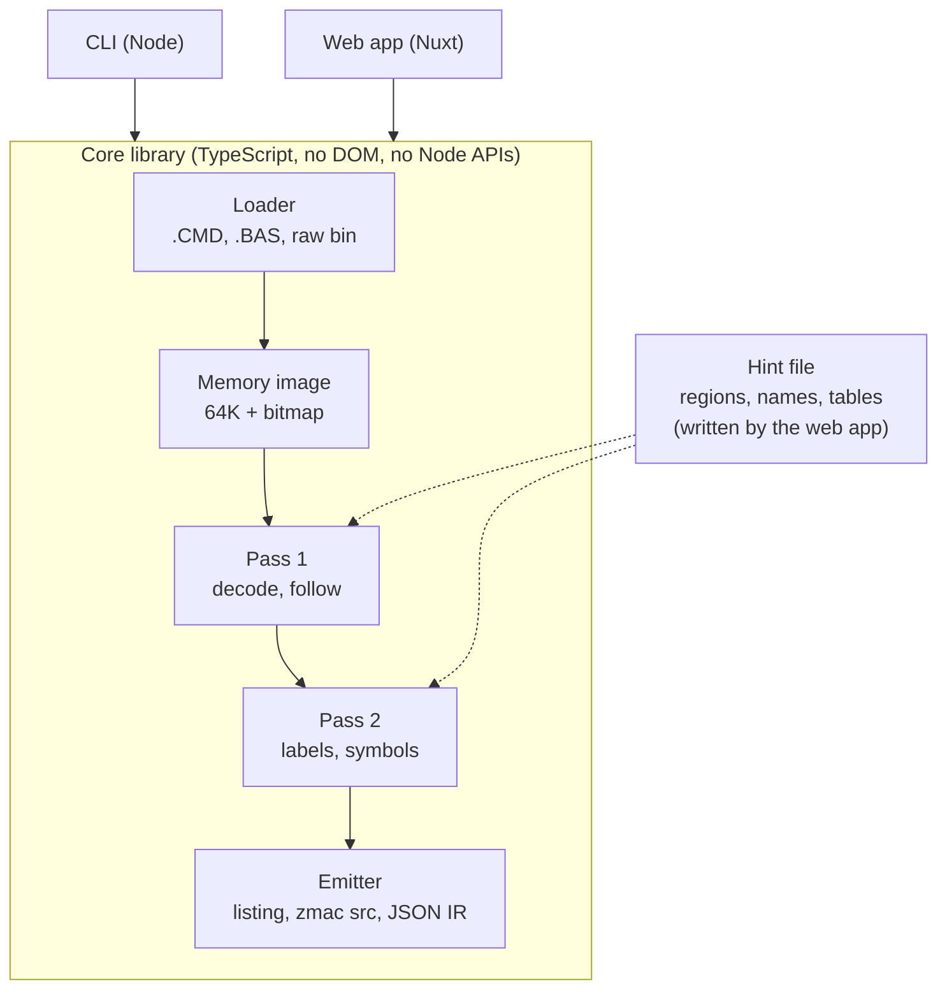
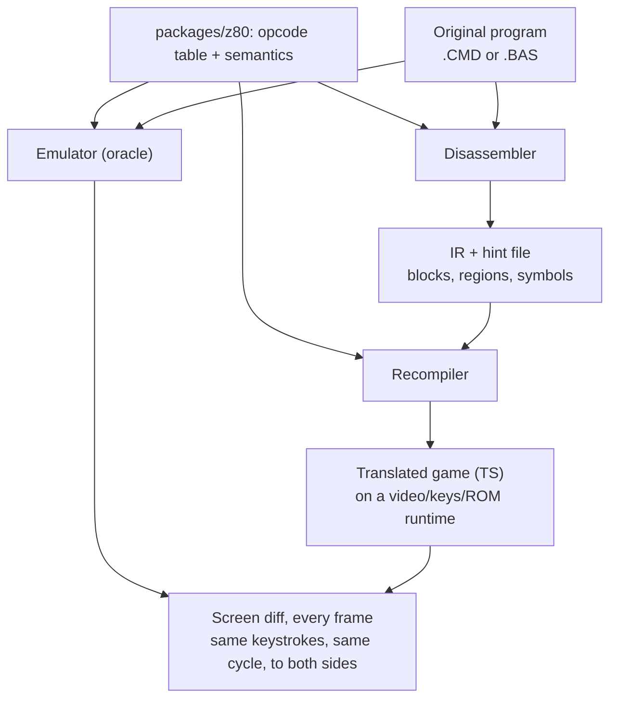

# Fugløy — TRS-80 Disassembler and Recompiler — Project Plan

Oct 14, 2026 · Chris Schweda

> Exported from the living doc at https://claude.ai/code/artifact/d5d7a36e-0c15-429c-a8ed-bee75aee6fde (rev 44, after two adversarial review passes; name and hosting added). Diagrams rendered here as Mermaid.

## Summary

A Z80 disassembler built for the TRS-80 Model I and Model III that reads .CMD load modules and tokenized .BAS programs directly, produces labeled source that reassembles to the same memory image, and runs in the browser as a drag-and-drop workbench. Generic Z80 disassemblers know nothing about TRSDOS, LDOS, or the ROM; this one treats the TRS-80 as the target.

Three things make it worth building:

- **Native .CMD and .BAS input.** Drop a file in; the tool rebuilds the memory image from load records or the BASIC line chain and starts at the entry point. BASIC programs are detokenized, and machine code hidden inside BASIC lines is found and disassembled in place.
- **A labeling pass with TRS-80 knowledge.** ROM entry points, DOS vectors, video and keyboard memory come out named. Jump and call targets get generated labels the user can rename.
- **An interactive listing.** Mark a range as code or data, rename a label, and the listing re-disassembles. A hint file persists every decision.

This document is in two parts. **Part 1 (v1)** is the disassembler and workbench, phases 1–4, fully specified. **Part 2** is the longer-term goal of recompiling programs to TypeScript and shipping them as static bundles; it is outlined here with its decisions recorded, and gets its own design document once phase 3 exists. The appendix holds the measured facts about the sample programs.

## Scope, audience, and rights

**Audience.** One user: the author. The workbench may be deployed publicly because it ships no copyrighted programs, only a tool and public-domain games. Nothing in v1 depends on other people using it; the sharing and registry ideas in Part 2 are conditional on that changing.

**What v1 is.** Phases 1–4: a core library, a CLI, and a static web workbench for Model I and Model III programs. v1 is done when a real game (asylum16.cmd) produces a listing with named ROM calls that reassembles to the original memory image, and that listing can be annotated and saved in the browser.

**What v1 is not.** Model 4 (banked memory, LS-DOS 6 SVCs), the emulator integration, the recompiler, and the bundler are Part 2. Cassette and disk-image formats are not planned as input (the workbench writes a `.CAS` as an export, decided in phase 4).

**Kill criteria.** If phase 2 cannot produce a round-trip-clean listing of a synthetic fixture within eight weeks of evenings (the estimate's top end plus a third), the approach is wrong and the project pauses for a redesign rather than proceeding to phase 3. Part 2 starts only after phase 3 produces a readable Asylum listing; if phase 4 is still unfinished after the estimate below has doubled, Part 2 is cut and v1 ships as a CLI.

**Rights.** The code is MIT. The programs used as fixtures (Asylum, Volcano Hunter, Voyage of the Valkyrie, and the later samples) are still under copyright and are never committed or distributed; tests that use them skip when they are absent. Public-domain programs are the exception: the games Wayne Westmoreland and Terry Gilman wrote, which Westmoreland released into the public domain in 1995, are committed under `examples/` (Sea Dragon, Rear Guard, Eliminator, Armored Patrol; a build that carries someone else's code or credit stays out, such as Sea Dragon's build rebuilt with Zeta's copyrighted OFFSET loader), so anyone can try the tool on real games and the real-program tests run in CI. Published ROM address maps are facts and may be used freely; the Model I and III ROM images are Tandy's and stay out of the repo. For Part 2, a TypeScript translation of a copyrighted game is a derivative work, and a runtime that reimplements ROM routines by reading the ROM is derivative of the ROM. Recompiled commercial games are therefore for personal use unless the rights holder agrees; public bundles are limited to public-domain programs (Super Star Trek is one) and the author's own code. Shipping "no original binary" does not change this and the plan does not pretend it does.

## Goals and non-goals

**Goals (v1)**

- Disassemble any Model I or Model III .CMD into zmac-compatible source that reassembles to the identical memory image.
- Detokenize any Level II .BAS into a listing, locate machine code embedded in it, and disassemble that code at its true addresses.
- Name every documented ROM, DOS, and hardware address automatically, with a separate table per machine.
- Let the user correct code/data boundaries and names interactively, with every decision saved to a hint file that survives rebasing.
- Run entirely client-side, with the same core library driving the CLI, the tests, and the browser.

**End state (Part 2)**

- Recompile a program to readable TypeScript and export it as a self-contained static bundle that plays on any static host.

**Non-goals**

- Running code inside the disassembler. v1 is static; execution-trace discovery arrives with the emulator in Part 2.
- Model 4 in v1. The Model 4 SVC table is cheap to add, but banked memory invalidates the single 64K image, so Model 4 is a Part 2 item with its own design.
- Cassette (.CAS) and DMK/JV3 images as input, CoCo, Model 100. Not planned. (Phase 4 writes `.CAS` tapes as an export.)
- Undocumented opcodes beyond SLL and the IX/IY half registers in v1.

## Landscape

No tool I found does all four of: read .CMD and .BAS natively, carry TRS-80 symbol tables, allow interactive code/data marking, and run in a browser. Each existing option covers part of it. The table was checked against each tool's own documentation or source on 2026-10-17 (sources below). I ran none of the tools, so a "No" or "None documented" means that documentation lists no such feature, and the table should be rechecked before any public claim is made.

| Tool | .CMD / .BAS input | TRS-80 symbols | Interactive marking | Browser |
| --- | --- | --- | --- | --- |
| z80dasm, dZ80 (zdis: unverified) | No: raw binary only | No; z80dasm reads a symbol file you supply | No: z80dasm takes a block file of code and data ranges, dZ80 an opcode map file such as an emulator writes | No |
| Ghidra (Z80 processor module) | None in its source; a loader could be written as an extension | No; the module names only the Z80's reset, RST, and NMI vectors | Yes: interactive disassembly and data definition | No: a Java desktop application |
| IDA Pro (Z80) | Not among its documented file formats, a list it calls partial | None in the Z80 module's source; the rest of the product unverified | Yes: its documentation calls interactivity the key feature | No: installs on macOS, Linux, and Windows |
| trs80gp debugger (George Phillips) | Runs .CMD, tokenized or ASCII .BAS, .hex, and zmac .bds files | Loads zmac .bds symbols; its manual says some models also have built-in symbols and source, without saying which (unverified for Model I and III) | None documented: breakpoints and a disassembly view around the program counter; Record → Bus Use writes a disassembly from the run's execution path | No; its JavaScript port, trsjs, runs in a browser with a sample debugger |
| TRSTools (Matthew Reed) | Extracts files from disk images; its viewer shows a .CMD as a Z80 disassembly and previews tokenized Model III BASIC | Unverified: the manual does not say whether the disassembly names ROM or DOS addresses | None documented: the viewer previews | No: a Windows program |
| DASM80 (GmEsoft) | .CMD, Intel HEX, or raw binary; no .BAS documented | User-supplied EQU and MAP files and an --svc option for LS-DOS SVC calls; no ROM or Model I/III DOS names documented | Screening files mark address ranges as code, data, words, jump tables, or relocated; not interactive | No: a Windows command-line program |
| DSMBLR III (MISOSYS, 1983) | .CMD files, directly | Generates labels from the references it finds; no ROM or DOS names documented | Screening data: address ranges read from a file or typed at a prompt, not marked in a listing | No: runs on the TRS-80 itself |

Checked 2026-10-17, from each tool's own documentation or source:

- z80dasm 1.1.6: its [man page](https://manpages.debian.org/trixie/z80dasm/z80dasm.1.en.html) (a binary file in, a `-b` block file, a `-S` symbol file) and [project page](https://www.tablix.org/~avian/blog/articles/z80dasm/). dZ80 2.0 (March 2002): [its page and FAQ](http://www.inkland.org.uk/dz80/), which say it supports only raw binary images and list scripts, opcode map files, and a two-pass mode. I read "dz80" as Mark Incley's dZ80; Jan Panteltje's dz80 3.0, which z80dasm is based on, was not checked separately.
- zdis: I found no Z80 tool by that name. The nearest, [CE-Programming/zdis](https://github.com/CE-Programming/zdis), is an eZ80 disassembler used in CEmu, so the table claims nothing for it.
- Ghidra (master; 12.1.4, of 2026-09-21, is the latest release): the [README](https://github.com/NationalSecurityAgency/ghidra/blob/master/README.md) ("user-interactive and automated modes", extension components), the Z80 [processor spec](https://github.com/NationalSecurityAgency/ghidra/blob/master/Ghidra/Processors/Z80/data/languages/z80.pspec) (its only default symbols are RST0 to RST7 and NMI_ISR), the [loader sources](https://github.com/NationalSecurityAgency/ghidra/tree/master/Ghidra/Features/Base/src/main/java/ghidra/app/util/opinion) (none reads .CMD, and no path in the repository's file list mentions TRS-80, TRSDOS, or LDOS), and the [Disassembly help topic](https://github.com/NationalSecurityAgency/ghidra/blob/master/Ghidra/Features/Base/src/main/help/help/topics/DisassemblerPlugin/Disassembly.htm).
- IDA Pro 9.4: [supported processors](https://docs.hex-rays.com/core/disassembler/specification/supported-processors) (Z80 comes with source code), [supported file formats](https://docs.hex-rays.com/core/disassembler/specification/supported-file-formats), the [disassembler overview](https://docs.hex-rays.com/core/disassembler/overview), the [installation guide](https://docs.hex-rays.com/getting-started/install-ida), and the Z80 module's [source](https://github.com/HexRaysSA/ida-sdk/tree/HEAD/src/module/z80) in Hex-Rays' SDK.
- trs80gp 2.5.8: the [manual](https://www.48k.ca/trs80gp.html) and [release notes](https://www.48k.ca/trs80gp-release-notes.html). trsjs, Peter Phillips's JavaScript port: its [page](https://trsjs.48k.ca/) and [debugger page](https://trsjs.48k.ca/trs80-debug.html).
- TRSTools 1.13 (2016): the [manual](https://www.trs-80.com/sub-utilities-trstools-manual.htm) and its entry on the [disk image utilities page](https://www.trs-80.com/main-emulation-disk-utilities.htm).
- Added after turning up in the search: DASM80 1.41 beta ([README](https://github.com/GmEsoft/DASM80)); DSMBLR III ([manual](https://tim-mann.org/trs80/doc/Dsmblr.txt)); and Z80Disasm ([manual](https://trs-80.com/sub-utilities-z80disassem-manual.htm); trs-80.com's [utilities index](https://trs-80.com/main-emulation-misc-utilities.htm) names its author, Matthew Reed), a Windows command-line disassembler with the same description as DASM80 and a smaller screening-file format (`$` bytes, `#` words), which the table leaves out.

The realistic alternative for a program you can run is trs80gp: load it and read it in the debugger, or record a run. Its Record → Bus Use writes a disassembly marked with how memory was accessed, and the manual says that once the program has been put through its paces the result "should be a good disassembly that can be assembled to produce the original code"; a program that relocates itself needs a relocated copy loaded first. Fugløy reads the file without running it, names ROM, hardware, and DOS addresses from cited tables, and keeps your names and code-or-data decisions in a hint file.

## Architecture

The disassembler is a TypeScript library with no DOM or Node dependencies, so one codebase runs in the CLI, the tests, and the browser.



The pipeline runs left to right. Pass 1 decides what each byte is; Pass 2 decides what to call it; the emitter renders the result as a listing, as zmac source, or as a JSON intermediate representation (IR: typed regions, basic blocks, control-flow edges, symbol table) that the web app and, later, Part 2 consume. The hint file is outside the pipeline and feeds both passes, so an interactive edit is a rerun, not a patch to internal state.

## Input formats

### .CMD load modules

The loader walks the record stream and writes each load block into a 64K `Uint8Array` with a parallel bitmap of loaded bytes. Everything downstream works from the image, never from file order.

| Record | Meaning | Loader action |
| --- | --- | --- |
| `01` | Load block: length, 2-byte address, data | Write at address; mark bitmap; log the block |
| `02` | Transfer address | Save as entry point; stop |
| `03` | End of load, no entry; a comment when records follow | Last record: stop; mark as not directly executable. Followed by whole records: skip it and keep loading |
| `05` | Module header (name) | Save for the listing header |
| `1F` | Copyright block | Save; emit as a comment |
| `04`, `06`–`10` | PDS / ISAM / patch records | Parse length, skip, log |

Rules the loader follows, each backed by a sample file in the appendix:

- The `01` length byte counts the two address bytes and wraps: 0 means 254 data bytes, 1 means 255, 2 means 256.
- Blocks may overlap. A later block overwrites an earlier one; the loader logs both extents so the listing can mark the range "patched at load time." **The overwritten bytes are gone from the image and are not recoverable by reassembly.** This is why the round-trip test compares images, not files.
- Blocks may be out of order or non-contiguous. Each run of loaded bytes becomes its own `ORG`.
- Bytes after the `02` record are ignored (tape-conversion debris is common).
- A `03` record followed by whole records is a comment, not the end: TRSDOS 2.3 and NEWDOS/80 load past it, and Rear Guard's cracked copies open with one. Only a `03` that ends the file, or one followed by debris, ends the load.
- A missing `02` is normal for overlays; the tool falls back to the lowest loaded address and says so.
- Format is detected from content, not extension (`.III`, `.bad`, and `.CMD` are all load modules).
- Raw binaries load at a user-supplied base address.

### .BAS tokenized BASIC

Level II BASIC saved to disk: optional `FF` header, then per line a 2-byte pointer to the next line, a 2-byte line number, the body with keywords as single bytes `80`–`FB`, and a `00` terminator; two zero bytes end the program. The pointers are absolute, so the file records where in memory it was saved from.

This matters because a class of TRS-80 games hides machine code inside BASIC lines so one `CLOAD` fetches both (Voyage of the Valkyrie: 190 of 257 lines are Z80 code, skipped by `GOTO 248`, entered through a `JP` that line 250 pokes into a system vector at run time).

What the .BAS path does:

- Detokenizes to a listing. A line whose `PEEK`, `POKE`, or `DEFUSR` names a constant address that the selected symbol tables know is followed by a note line (`;   14400 = $3840 memory-mapped keyboard (KEYBOARD+64)`: a note line, not a trailing comment, because `;` is BASIC's `PRINT` separator). Both machines' ROM tables name 16548/16549, the program-start pointer, and 16526/16527, the USR vector, so their notes carry no machine tag; 14400 is keyboard row 7. `USR`'s argument is a value, not an address, so it gets no note.
- Finds hidden code by **parse validity**, not byte statistics: a line is BASIC if its body parses as tokens with well-formed operands; a line that fails to parse is treated as data and offered to Pass 1 as a candidate code region. Byte histograms do not work here because `C3`, `CD`, `C9`, `ED`, `DD`, and `FD` are all in the token range. The test has a known blind spot: code whose bytes also form valid BASIC (`XOR A / RET` is `LPRINT INKEY$`) passes as BASIC; a `code` hint overrides it, and a jump into such a line is reported with the hint that would fix it.
- Places each hidden region at its true address: line *N*'s body sits at `ptr(N−1) + 4`. Those bytes go into the same 64K image the .CMD loader fills and Pass 1 and Pass 2 run unchanged.
- Mines entry points from the BASIC text: `DEFUSR=`, pokes to the USR vector, and `POKE addr,195` followed by two pokes of an address.
- Offers rebasing, since the saved addresses are an accident of the saving machine's memory map. Hidden code in such programs is usually position-dependent, so a rebased listing shows absolute references pointing at the old addresses; the tool marks those and the listing header states the original base. Hints survive rebasing because they are keyed by block and offset, not address (see Hint file).

## Pass 1: decoding and code discovery

Pass 1 produces a typed map of the image: each byte is code, data of a known kind, or unknown.

**Decoder.** Opcode tables are generated from the Z80's octal structure (x/y/z/p/q decomposition), not typed by hand, covering unprefixed, `CB`, `ED`, `DD`/`FD`, and `DDCB`/`FDCB`. Each instruction records length, mnemonic, operands, cycle count, and control-flow effect (fall through, jump, call, return, halt). The table is a separate package so Part 2 can share it.

**Recursive descent.** From the transfer address and any user entry points, the walker follows every statically resolvable `JP`, `JR`, `CALL`, `DJNZ`, and `RST`, ends a block at `RET`, `JP (HL)`, `JP (IX)`, `JP (IY)`, and unconditional jumps (continuing at the target when known), and queues both arms of conditional branches. Unreached bytes stay unknown.

**Indirect jumps are manual in v1.** `JP (HL)` through a computed table is the standard game-loop dispatch on this machine, and nothing in v1 discovers the table automatically. The hint file lets the user declare a table (base, entry count, entry width) and its entries become roots. Automatic discovery is a Part 2 item, via execution tracing.

**Heuristics for unknown regions**, always overridable:

- Runs of printable ASCII ending in `0DH`, `03H`, or `00H` become strings.
- Consecutive 2-byte values that all land in loaded code are proposed as a jump table, not applied.
- The byte after a `RST 08H` is an inline parameter (the ROM's syntax-check idiom) and is marked data. No other RST takes an inline byte.

**Overrides.** The hint file can force a region to code, bytes, words, or string, add an entry point, declare a jump table, or mark an address never-code. Overrides win.

## Pass 2: labels, symbols, and annotations

Pass 2 never changes what a byte is, only what it is called.

**Label synthesis.** Every jump, call, or data-reference target gets a label whose prefix records the use: `L5210` jump target, `SUB_5340` call target, `DATA_5400` referenced bytes, `TBL_5480` jump table. `LD HL,nnnn` and `LD DE,nnnn` operands inside a loaded region are data references; outside, constants. (Phase 2 applies the same rule to `LD BC|IX|IY,nnnn` and to every `(nnnn)` memory operand; `LD SP,nnnn` and port numbers stay constants.)

**Symbol tables**, one set per machine and DOS, chosen by the machine and DOS selectors (`--machine`, `--dos`; the DOS is chosen, not merged, because the manuals name the same address differently):

| Table | Contents |
| --- | --- |
| Level II ROM, Model I | Documented entry points (`$0013` and `$001B` read and write a byte through a device control block, `$0033` output char, `$0049` wait key, `$1A19` BASIC ready, and the published list), RAM vectors and system variables in the `$4000` page |
| Level II ROM, Model III | Same documented entry points where Tandy kept them compatible, plus Model III-only routines and RAM differences; an entry whose address differs from the Model I table, or that the Model I table lacks, is tagged `[Model III]` (and the Model I table's `[Model I]`) so a listing says which machine it assumed |
| Hardware, one table per machine | The keyboard at `$3800`, video RAM at `$3C00`–`$3FFF`, and the cassette port `$FF` on both; the Model I's memory-mapped device registers at `$37DE`–`$37EF`; the Model III's I/O ports `$E0`–`$FF` |
| TRSDOS 1.3 (Model III) and LDOS 5.1 (Model I and III, a table for each) | RAM-resident addresses from `$4000` up, in each DOS's own spelling: `$JP2DOS`, `$OPEN`, `$READ` in TRSDOS 1.3; `@EXIT`, `@OPEN`, `@READ`, `@WRITE`, `@CLOSE`, `@DSPLY` and the rest of the `$4400`-page vector block in LDOS. A ROM address keeps its ROM name, so `$0049` is never `@KEY` |
| LS-DOS 6 (Model 4) | `RST 28H` supervisor calls named from the preceding `LD A,n` (`LD A,10` / `RST 28H` reads as `@DSPLY`). Cheap to include for reading launchers like GO.CMD; full Model 4 support is Part 2 |

Each table is a data file with a source citation per entry. Published maps disagree in places; the citation is how disagreements get settled later. `pnpm symbols` validates the files, compiles them into a generated module, and writes `packages/disasm/data/symbols/COMPARISON.md`, which sets the Model I and Model III ROM maps side by side.

**User names and comments** come from the hint file and apply everywhere the address is referenced. Known calls get a trailing comment with the routine's purpose. Load-time patches, unreachable code, and overlapping blocks get a comment stating the oddity.

## Hint file

The hint file is the one piece of persistent state in v1. Decisions, made now:

- **Format: line-oriented text**, one directive per line, so it diffs in git and can be hand-edited. Example directives: `code`, `bytes`, `words`, `string`, `entry`, `table <count> <width>`, `name <label>`, `comment <text>`, `note <text>` (a line of a block comment above the address; several in a row make a paragraph, added 2026-10-17 for the Explain tab design), `nocode`, and (phase 2) `relocate <addr> <length>`, which declares that the bytes at this offset execute at another address: they are analyzed there and emitted under zmac's `.phase`.
- **Names and comments outside the program**: `at <addr> name <label>` and `at <addr> comment <text>`, one per line, keyed by a runtime address instead of a block offset (`$7F00`, `7F00H`, `0x7F00`, or decimal). They name RAM variables and other addresses the file does not load, and the listing, the zmac source, and the IR use them like any user name: zmac gets `SCORE EQU 7F00H` (with the comment, if any), and the listing header says `; name SCORE = $7F00`. An `at` hint on an address the image loads is not applied and draws a warning (`at $5200 names a loaded address; use block 0:$0000 instead`), because inside the program the block-relative form is the one that survives relocation and variant builds. `at` names follow the same rules as `name` (identifier, not reserved, not a generated-label shape, unique ignoring case). Example:

  ```
  at $7F00 name SCORE
  at $7F00 comment player score, two bytes
  ```
- **Keys are block-relative and block identity is content-based**: `block <index>:<offset>` where a block is a loaded run identified by its original start address, its length, and a hash of its first 64 bytes. When a hint file is applied to a different file, blocks are paired by length and hash, not by position, so the same hints apply to Asylum 1b, 1c, and 1d, and a variant with an extra 2-byte vector block (1e) still matches on its main run. Unmatched blocks' hints are reported, not silently dropped.
- **Identity**: the file header carries the SHA-256 of the input program. A hint file is applied block by block, by content (above), so a file written for one build applies to a variant; a program hash that differs is a warning, and the workbench refuses a hint file only when no block matches at all.
- **Storage**: a file on disk (CLI) or IndexedDB (browser), downloadable; nothing else in v1.

Part 2 adds annotations for stores that patch code and for interrupt hooks; the format is designed to take new directives without a version bump.

### Label and coverage file (`--labels`)

Added 2026-10-18 (emu phase 3). The emulator writes a JSON label and coverage file for a program it ran (`docs/label-format.md`, §8 of the emu spec); `@fugloy/disasm` reads it on its own, from the format document (`parseLabelFile`, `labelAnnotations`, `withLabelFile`), and the CLI applies it with `--labels <path>`:

- **What applies.** Every label inside loaded memory: `kind: code` becomes a root; a valid name becomes a user name (a name of the generated shape, `L`, `SUB_`, `DATA_`, or `TBL_` and four hex digits, means "no name given": the address is still a root, Ruling 9); `evidence` becomes the comment `observed: <evidence>`; `kind: data` with a `size` types that many bytes as `DB`. Every `EXEC` bit inside loaded memory becomes a root (an instruction that only ran is not marked `entry` in the listing), and each maximal run of loaded bytes that was read and neither executed, fetched as an operand, nor written becomes a `nocode` run: a path that lands on any byte of it ends there (`path ends at $XXXX (read, never executed, per the label file)`), where a hint's `nocode` stops only at its own address. Read-only → data is a heuristic (code the program only read, a checksum over itself, is typed as data too), so a run never ends a path at a root from any other source (the module entry, a hint's `entry` or `code`, `--entry`, a `.BAS` program's mined entries and code lines, a hint table's targets): descent cuts the run short at that root, and paths from label-only roots run after all others. An executed address that is a root for another reason (the module entry, `--entry`, a mined or hinted entry, a code label) keeps its `entry` mark. Names and evidence containing control characters are refused, as is an empty `evidence` on an observed label. Coverage keys other than `"0:0"` draw a warning and are ignored.
- **Addresses are runtime addresses**, because they came from the running machine: the file applies to the analysis space, so under a relocate hint a label at the destination applies and one at the moved source's file address is outside loaded memory.
- **Code that changed at runtime is not the file's code.** The file's `write` field marks bytes written while coverage was on or changed since the load. An executed instruction any of whose bytes is written, or a code label at a written address, outside a relocate hint's runtime region, is skipped (the disassembler never states an unproven value), with one summary warning: `N executed or labelled addresses changed at runtime (…); their coverage is not applied to the file's bytes (a relocate hint says where moved code runs)`. A path from a label-only root also ends before a changed byte; paths from other roots ignore `write`. Data labels apply even where written.
- **Identity (Ruling 10).** A label file is keyed by address, so one whose `program.sha256` is present and differs from the SHA-256 of the program file is refused: nothing applies and the CLI exits 2 (a hint file, matched by content, only warns). A file without `sha256` applies.
- **Hints win (Ruling 11).** Hint names and comments stand; a label name the hint file uses elsewhere is dropped; a label override that overlaps a hint override is dropped; entries are unioned.
- **Output.** The listing header carries `; labels: <file>: N names, N roots, N data runs applied` after the hints line, and the file's warnings as `; warning:` lines; the IR carries the same summary as `labels`. `--labels` is refused with `--sweep` and with `--write-hints`; a file that does not parse, or is refused, prints `fugloy: <path>: <message>` and exits 2.
- **When to start coverage.** From the load is the natural default (and what the MCP server does): a self-relocating program's copy writes every byte it moves, so no read-only run covers the moved code. Before the `write` rule, coverage taken across Sea Dragon's LDIR from `$5200` to `$497F` cut the decoded instructions from 2,896 to 1,114; now it keeps all 2,896. Started later (at `$497F`, as the committed session is), `write` still marks what the copy changed, and the game's own data reads show as read-only runs.
- **Sea Dragon.** `examples/sea-dragon/seadrg01.labels.json` is the file of a scripted session (`packages/emu/scripts/sea-dragon-labels.mjs`: boot, load, coverage on from `$497F`, title screen, ENTER), committed so CI applies it without a ROM. With the committed hints each of its 459 roots starts an instruction the hints decode (none lost, no overlap, no hint name lost) and it adds the observed call counts of 3 subroutines; without the hints it skips the 165 addresses the copy changed, with one warning, and decodes nothing whose bytes differ from what ran (`packages/disasm/test/sea-dragon-labels.test.ts`). Before the `write` rule, the same file without hints decoded 1,000 instructions, 990 of them from bytes that never ran there.

## Web app

A static Nuxt 4 site running the core library in the browser. Files never leave the machine. Built in phase 4 to the design in `docs/superpowers/specs/2026-10-17-phase4-web-workbench-design.md`; this section records what it does.

**Layout: two facing pages**, in the manner of Inform 7's IDE, with a divider that drags. The top bar holds the wordmark, the file name, the **machine** picker (Model I, Model III, Model 4 symbols only) and the **DOS** picker, **Export ▾**, **Your work** (back up and restore), and links to the Manuals, Technical details, and About pages. A narrow screen shows one page at a time with a "best on a desktop" notice and never scrolls sideways.

- **Left page:** the **Listing** and the **Hints** tab (the current hint file as text, read-only, with matched and unmatched blocks, so each edit is seen landing as a line). **Source ✎** (phase 5B) is the editor for the user's own Z80 sources.
- **Right page:** **Explain** (below), **Symbol** (a name's address, purpose, citation, and every use, or a program label's callers, jumpers, and readers), **Index** (every label, routine, table name, and proposal, filterable), **Program** (the spec sheet, below), **Manual** (your own copy of a cited manual), and **Run ▶** (phase 5B), which assembles the source and runs it on an emulated TRS-80.
- **Status line:** size and blocks, percent decoded as code, entry, the cursor, the selected machine and DOS, and the save state ("saved", "unsaved", "no hints yet", "no changes yet", "not saved (storage unavailable)", "not saved (saved hints kept)", and, for a listing a Run made from a source, "not saved (assembled from your source)").

**First screen.** The workbench is the home page. Before a file is open, the left page is a drop zone for a .CMD, a .BAS, or a raw binary (which asks for its load address, as `--base` does), and beside it are one-click buttons for the four public-domain games in `examples/`, each opening its main build (Sea Dragon opens `seadrg01.cmd` with its committed hints), with a menu of the other builds. A file is told by its content, never its extension: anything that is neither a .CMD nor a .BAS (a JPEG, a disk image, an empty file) says what it is not and offers "load as raw binary at…", a PDF points at the Manuals page, and a hint file dropped on an open program applies to it.

**Listing:** address, bytes, label, mnemonic and operands, comment, exactly the text the CLI prints, with each row's line number in the whole listing in a gutter of its own (not part of the text; the status line gives the total), built from structured rows in `@fugloy/disasm` (`listingRows`, `basRows`) so the two cannot drift. It is virtualized and syntax-highlighted; table names and labels are links that open the Symbol tab. A pure .BAS program shows its BASIC listing and is read-only; one with hidden machine code shows the pass 1 listing and is editable. The plan's named risk held: the listing scrolls an 18,562-row raw 48K load at a steady 60 frames a second, and a jump to an address paints within a frame (numbers in `CHANGELOG.md`).

**Keys**, with the same actions on a right-click menu (Shift+F10 opens it from the keyboard):

| Key | Action |
| --- | --- |
| **C** / **D** / **W** / **S** | mark the selection code / bytes / words / string |
| **T** | declare a jump table from the selection |
| **N** | rename the label under the cursor |
| **;** | comment the cursor row |
| **:** | write a block comment above the routine around the cursor, or above the cursor's line |
| **G** | go to an address or a label: `$4B9E`, `0x4B9E`, or `4B9EH` is an address; otherwise a label name, ignoring case (so a label `CAFE` wins); otherwise bare hex of one to four digits (`4000` is `$4000`); decimal needs a `#` (`#19358`); past `$FFFF` is refused. UI input only: the hint file keeps its own number rules |
| **Enter** | follow the operand's target |
| **Alt+←** / **Alt+→** | back / forward through targets followed |
| **⌘Z** / **Ctrl+Z**, **⇧⌘Z** / **Ctrl+Y** | undo / redo |
| **Esc** | back out of the current action |

Every edit becomes a hint-file directive, the library re-analyzes, and the listing re-renders with the cursor on the same address. **N** and **;** also work on addresses outside the loaded image, through the hint file's `at` directive. A rename to an invalid name (a reserved word, a generated-label shape, a name already used ignoring case, a table name) is refused inline with the reason. Undo and redo are stacks of hint files, so undo and the hint file never disagree; the history lives in the page, so a reload starts a new one.

**Explain** (added 2026-10-17, to the design in `docs/superpowers/specs/2026-10-17-explain-tab-design.md`; engine in `packages/disasm/src/explain/`, no DOM). A click on a listing row opens the Explain tab on that row, and while it shows, every cursor move re-explains, so code can be stepped through a line at a time. A code line gets one or two plain-English sentences with its real addresses, values, and names filled in (`Copy $3681 (13,953) bytes from $5200 (L5200) to $497F (L497F)`), using only register values proven on every path to the line, and stating none it cannot prove. Each address the line uses gets a "what's at" preview (the listing lines there, or the symbol-table entry with its purpose and citation) that moves the cursor there. Patterns are recognized across lines: block copies and fills, counted loops, delay loops, and the move a loader stub makes. A quieter strip gives the size, T-states (both when conditional), the flags changed (from `@fugloy/z80`'s generated `flags` field), and "undocumented". The **routine summary** says what the routine around the line provably does: its length, who calls or jumps to it, how it ends, screen writes by row and column, keyboard reads, ports, ROM and program calls, data read and written, and loops; **Use as comment** opens it in the Block comment box for the user to rewrite. A data row explains its **data region**: its extent (to the next code or label, user names included), who loads its address, the variable that address is kept in, the loop that reads it and the tests that split its bytes into kinds, and a picture of its bytes in the TRS-80 character set at a width the user picks (8, 16, 32, 64, or any). A `.BAS` listing says Explain covers machine code. Explain states facts only; meaning comes from the user's names and comments.

**Block comments.** The hint file's `note` directive: lines of prose above an address, printed as `;` lines above its label in the listing and the zmac source, and carried in the IR as `notes`. **:** (or **Block comment…** on the right-click menu) opens a box prefilled with the notes there, offering "above the routine" or "above this line" when the cursor is inside a routine; saving replaces the notes at that address as one undoable edit, and emptying the box removes them. Sea Dragon's committed hint file is the example of a fully annotated program: names and block comments for its loader, title screen, main loop, cavern drawing, controls, sound, scoring, and data, researched with Explain and marked "probably" where they are a reading of the code.

**Spec sheet (Program tab).** The header's "detected machine" became an evidence-based verdict computed in `@fugloy/disasm` (`programFacts`): runs on Model I, Model III, both, or unknown, with the evidence in plain words from phase 3's ROM comparison and hardware tables ("Writes port `$EC` (MODEPORT), which only the Model III has."). The sheet also gives the history of a bundled game (authors, year, rights), loading (records, load range, entry and how it was found, relocations in words, memory needed, a 64K memory-map strip), what the program talks to (hardware, ROM and DOS calls, each a link), code statistics, and the analysis's diagnostics and proposals, each with a one-click "apply". A program first opens under the verdict's machine when it names exactly one, else Model III; each bundled game opens under the machine its manifest gives (Eliminator under Model I, since `elimin8d` calls `$01D3`, which only the Model I ROM has). The verdict never overrides the picker, and the picker changes the symbol tables only.

**Saving.** Hints save automatically to IndexedDB, keyed by the program's SHA-256, beside the per-program machine and DOS choice; a bundled game's committed hints are saved only once the user changes them. A hint file saved for one build is offered to another build whose blocks match. With IndexedDB unavailable the workbench still opens and edits, and says the work is not saved. **Back up** writes one JSON file of every saved hint file and setting (never manuals, ROMs, or programs); **Restore** merges it in, asking before it replaces a program's hints.

**Export ▾:** the zmac source, the hint file, and the JSON IR, plus a **.CMD** load module (the loaded image with the program's entry and name record; it reloads through `loadCmd` to the same image) and a **.CAS** tape (a SYSTEM tape for machine code, a BASIC tape for a .BAS), which still downloads with a warning when the program calls the DOS or loads under `$4200`. Phase 4 edits never change program bytes, so neither needs an assembler.

**Manuals (bring your own).** The `/manuals` page lists every work the symbol tables cite, by title, author or publisher, year, and edition or catalog number, with its archive.org cover where a scan exists (fetched from archive.org, never hosted). You add your own PDF, recognized by SHA-256 when it is a known archive.org scan, or picked by hand otherwise; it stays in IndexedDB. A citation then opens the Manual tab at the cited printed page, through a checked printed-page-to-PDF-page table per scan, with the name or address marked when the PDF has a text layer. Without the manual, a citation offers "Open page N on archive.org" and "Add this manual". PDF.js loads only when a manual is first opened.

**Pages:** `/` (the workbench), `/manuals`, `/technical-details` (the Inside Fugløy explainer), and `/about` (what Fugløy is, that files never leave the machine, and credits), all with the SEO listed under phase 4 below.

**Hooks for phase 5.** The **Source ✎** and **Run ▶** tabs (live since phase 5B) hold the assembler's editor and the emulator; the listing's row model and the hint file are the interfaces they will build on.

**Machine selector:** Model I, Model III, or "Model 4 (symbols only)", the last of which enables SVC naming for reading launchers without claiming to understand banked memory. Full Model 4 support arrives with Part 2. The selector changes the symbol table only.

## Testing

- **Opcode exhaustion.** Generate every encoding across all prefixes, decode, and compare to a published reference table checked into the repo.
- **Synthetic .CMD fixtures.** A .CMD writer in the test suite builds files for every loader rule above: 254/255/256-byte blocks, out-of-order and overlapping blocks, `05` and `1F` records, no `02`, trailing bytes, every PDS/ISAM type.
- **Synthetic .BAS fixtures.** A tokenizer in the test suite builds BASIC programs with and without embedded code, saved from two different base addresses, to test detokenizing, hidden-code detection, address placement, and hint portability.
- **Image round trip.** Disassemble a fixture, assemble the output with a pinned zmac, load the result, and compare the two **memory images and bitmaps**. This catches label, `ORG`, and operand-encoding mistakes. It does not and cannot compare files.
- **ROM smoke test.** When a ROM image is present locally, disassemble it and assert the documented entry points decode as code and that descent reaches a minimum fraction of the image. Skipped otherwise.
- **Real-program snapshots.** A gitignored `sample/` holds the copyrighted sample programs and `examples/` the committed public-domain ones; expected-output snapshots are committed; tests run when the files are present and skip when not.
- **Web app.** Vitest unit and component tests for marking, renaming, saving, and exports; Playwright against the generated site, in CI, for every flow, with one spec (`done-criterion.spec.ts`) telling the story end to end on Sea Dragon: open, rename, comment, undo, reload and find the work saved, export zmac equal to the CLI's for the downloaded hints, export a .CMD that reloads to the same image, and drop a file that is not a program. A render test scrolls an 18,000-row listing; its timing limits apply only locally (`FUGLOY_PERF=1`), so a slow CI runner cannot fail the build. Local-only checks skip without their files: asylum16 annotated and saved under Model I (`asylum.spec.ts`, the done-criterion), and the exported Sea Dragon .CMD and .CAS run in `@fugloy/emu` on the real Model III ROM (`emulator-run.test.ts`).

## Phases and estimates

Estimates are in evenings-and-weekends calendar time and assume one person. They are deliberately pessimistic; the earlier draft's "a few evenings" was not an estimate.

1. **Core decoder and loaders.** Generated tables, exhaustion test, .CMD and .BAS loaders, detokenizer, memory image, and the two synthetic fixture writers (a .CMD record writer and a BASIC tokenizer) the tests depend on. Deliverable: a CLI that prints a linear-sweep listing of any .CMD and a detokenized listing of any .BAS. **2–3 weeks.**
2. **Pass 1 and Pass 2.** Recursive descent, string heuristic, jump-table proposal, hidden-code detection, label synthesis, hint-file reader/writer, zmac emitter, image round-trip test. Deliverable: every synthetic fixture round-trips; Valkyrie's hidden code disassembles at the right addresses. **4–6 weeks.** Kill criterion applies here. **Met** (sub-projects A–C): every synthetic fixture and every present real program round-trips; Valkyrie's code lines 2–247 disassemble at their true addresses from the entry line 250 plants. Phase 2 also added rebasing, a `relocate` hint emitted under zmac's `.phase`, and proposals for jump tables and LDIR loader stubs. Released as v0.2.0 on 2026-10-16.
3. **Symbol tables.** Model I and Model III ROM tables (two maps entered and compared, not one), hardware table, LDOS 5/TRSDOS 1.3 vectors, LS-DOS 6 SVC names, machine selector, per-entry citations; verify the Landscape table's claims about other tools before any public README repeats them. Deliverable: Asylum and Volcano Hunter listings with named ROM and DOS calls. **3–4 weeks for the first hundred entries of each ROM map plus the DOS vectors; the tables keep growing afterward.** **Met**: eight cited JSON tables hold 634 entries from ten published works, every entry citing a page. They are the Model I ROM (125) and the Model III ROM (150, with the `$4000`-page RAM Decker gives for both machines), entered separately and compared (102 addresses shared, 4 different, 19 Model I only, 44 Model III only); hardware (13 for the Model I, 17 for the Model III); TRSDOS 1.3 (24); LDOS 5.1 (107 for the Model I, 101 for the Model III); and LS-DOS 6's 97 service calls. `--machine 1|3|4` (default 3) and `--dos trsdos|ldos|none` choose the tables. The names reach the listing, the zmac source (each defined by an `EQU`, so the round trip still rebuilds the identical image), the IR, and note lines under `.BAS` lines that `PEEK`, `POKE`, or `DEFUSR` a known address. asylum16, listed with its hints under `--machine 1`, has 16 of the 17 ROM addresses it reaches named; the 17th, `$0112`, is banner text in the ROM (Decker p. 80), not a routine, and four addresses above its image are in no table. Volcano Hunter calls no ROM or DOS routine at all: its listing names its hardware (`MODEPORT`, `CASSETTE`, `KEYBOARD`), and `fixtures/hints/volcano.hints` relocates its game to the runtime address its loader copies it to, `$42E9`, which lifts the decoded share from 26% to 34%. So the deliverable's "named ROM and DOS calls" holds for Asylum, while Volcano Hunter has none to name; both round trip. The Landscape table was checked against each tool's documentation and corrected on 2026-10-17. Released in v1 (1.0.0) on 2026-10-17.
4. **Web workbench.** Virtualized listing first, then drop zone, marking, renaming, side panel, export, IndexedDB persistence; Netlify deploy, with full SEO: a title and description on every page, canonical URLs on `app.fugloy.dev`, Open Graph and Twitter card tags (`summary_large_image`) whose image is the social card `docs/images/og-image.png` (1200×630, at an absolute URL, with alt text; added 2026-10-16), favicons from the card's ø tile, `robots.txt`, `sitemap.xml`, and JSON-LD (`SoftwareApplication`). Deliverable: the v1 done-criterion above. **6–8 weeks.** **Met and released** as v1 (1.0.0, 2026-10-17), deployed on Netlify, now at app.fugloy.dev: the workbench described under "Web app", with the Manuals, Technical details, and About pages and the SEO above. The done-criterion is met locally: in Chromium, asylum16 opens with `fixtures/hints/asylum16.hints` under Model I, shows its ROM calls named (`CALL $KBCHAR`, `CALL $CSHIN`), and keeps a rename and a comment across a reload; its listing's reassembly is the CLI's round trip from phase 3. CI runs the same flow on Sea Dragon. The exported Sea Dragon `.CMD` and `.CAS` were run in `@fugloy/emu` on the real Model III ROM: both draw the game's title screen, identical to the original's, and answer ENTER with "1 or 2 Players?". The Explain tab and block comments were added the same day (see "Web app"), with Sea Dragon's hint file annotated as their showcase. The custom domain `app.fugloy.dev` waits on DNS.
5. **Assembler and IDE** (after v1; added 2026-10-16). Write Z80 assembly in the workbench, assemble it to a `.CMD`, and run it on an emulated Model I or Model III beside its listing: an IDE in the way Inform 7 has one for its language. The assembler is either the author's own Z80 assembler, wired in the way the emulator reuses the author's emulator, or an encoder built by inverting the generated opcode tables, with the test suite's `.CMD` writer as its output stage. It calls ROM routines by name from phase 3's tables and warns when a program uses a ROM address whose code differs between the Model I and Model III ROMs (the four addresses phase 3's comparison classes as different: `$0050`, `$01D9`, `$0212`, `$03C2`). zmac stays the referee: on every zmac source the round-trip corpus produces, the new assembler must build the identical image. Needs phase 3, phase 4, and the emulator's loaders and debugger API (emu phases 2–3). Deliverable: a program typed in the workbench runs on either model, and the assembler matches zmac byte for byte across the corpus. **4–6 weeks; less if the author's assembler can be adopted.** Design `docs/superpowers/specs/2026-10-18-phase5-assembler-ide-design.md`, split into 5A (the assembler), 5B (Source ✎ and Run ▶), and 5C (the running line). **5A merged** to main (plan `docs/superpowers/plans/2026-10-18-phase5a-assembler.md`, 2026-10-18), unreleased; it releases with core. The author's assembler was not adopted (it miscompiles `LD A,(3C00H)` and ignores a second `ORG`); `@fugloy/asm` inverts `@fugloy/z80`'s tables instead. It assembles zmac's syntax for the disassembler's constructs (labels, every number form, zmac's expression precedence and parenthesis rule, `ORG`, `EQU`, `DEFL`/`=`, `DB`/`DW`/`DS`, `.PHASE`/`.DEPHASE`, `END`) to an image, an entry, symbols, a listing, a source map by run address, and a `.CMD` whose transfer address is END's entry or the first assembled byte. Its errors are sentences on the line at fault, with suggestions for typos and ROM names and the exact rewrite for zmac's other spellings (`JP HL`, `PUSH A`, `IN 38H`, the 8080 `M`). A model's ROM and hardware names (and a chosen DOS's) are predefined at the lowest priority, so a source's own definition wins. A number at one of those four addresses (a CALL or JP target, or a memory address in parentheses) draws a note naming both ROMs' meanings: a warning when no model is named, info when one is; a predefined ROM name is never noted, since it already says which machine it means. `fugloy asm` is the command. zmac stays the referee: the round-trip harness checks both assemblers on every source, and `pnpm asm:corpus` over the 85 local real programs (3 of them also with hints), named for the Model III and again for the Model I, matches zmac on every one. asm is stricter than zmac in a listed set of cases, where it gives an error rather than different bytes (`packages/asm/README.md`). The starter program, `packages/asm/examples/clear-screen.z`, blanks the screen on `@fugloy/emu`. **5B built** on branch `phase5b` (plan `docs/superpowers/plans/2026-10-18-phase5b-source-run.md`, 2026-10-18), not yet merged: **Source ✎** (CodeMirror 6, lazy; each error marked on its line with a one-click fix) and **Run ▶**, where one press (or Ctrl/⌘+Enter anywhere in the workbench) assembles the source and runs it on a fresh `@fugloy/emu` Machine with a canvas screen and the keyboard. It runs on the user's ROM, kept in this browser only and never in a backup, or, with none, on Fugløy's own stub ROM for a program that never calls the ROM; one that does is refused with a sentence naming its line. A clean Run refreshes the source's own listing quietly, and never replaces a program opened from a file. **Open as source ✎** (the Program tab and Export ▾) turns a disassembly into a new source, the zmac text Export writes, on the program's own model; asm builds it back to the same image and entry (Sea Dragon on the user's Model III ROM reaches its title from it), and a text that does not reassemble exactly opens with a one-line note naming the first address that differs. The stub ROM is Fugløy's own `stub-rom.z`, assembled at run time; the screen's glyphs are X.Org's public-domain misc-misc fonts, not a ROM's character generator. All five tasks are done; the lazy chunk sizes and the first screen's growth (+4.3 KB gzip, within the 5 KB budget) are in the CHANGELOG. 5C, the running-line highlight, is next.
6. **Learn assembly with Fugløy** (after phase 5; added 2026-10-17). An introduction to assembly language for people who have never programmed, not only for retro fans. The Z80 is a good first machine: small, regular, and straightforward, with a screen that is just memory. Feedback is instant: Explain's tutor voice describes each line as it is written, and phase 5's assembler and the emulator run the code at once. The core is a tutorial that builds a Space Invaders-style game from a blank page: a base moving along the bottom, a shot going straight up, invaders marching left and right and inching down, the way games like Big Five's Super Nova were built. Lessons can open the public-domain games in `examples/` side by side, to show how Westmoreland and Gilman did the same things (Sea Dragon's annotated hint file is the model). Needs phase 5 and emu phases 2–3. To decide at design time: the audience, the lesson format, and how much of the TRS-80 to hide. No estimate yet.

Total v1: roughly four to five months of spare time. Part 2 is not estimated until phase 3 is done, because its first step (emulator integration) depends on how the emulator's CPU core takes to the shared opcode table.

## Risks and open questions

**Risks**

- Code/data separation needs a human in v1. Heuristics propose; the user decides. Mitigation: make marking fast, and get execution tracing early in Part 2.
- Opcode-table errors are silent. Mitigation: generated tables and the exhaustion test on every commit.
- Symbol sources disagree. Mitigation: one data file per table, a citation per entry.
- zmac drift. Mitigation: pinned version in CI.
- Listing performance in Vue. Mitigation: virtualize first, prototype before building the rest of phase 4.
- Scope creep toward Part 2. Mitigation: the kill criteria and the rule that Part 2 gets its own document.

**Open questions**

- ~~Which undocumented opcodes to emit and how to spell them (zmac's names or Zilog's).~~ Decided in phase 2: only `SLL` and the IX/IY half registers (`IXH`, `IXL`, `IYH`, `IYL`) are emitted as instructions, spelled as zmac accepts them, which is also how the listing spells them; every other undocumented encoding is emitted as `DB`. The pinned zmac assembles all 1786 non-prefix encodings back to their own bytes except the redundant `ED 63`/`ED 6B` forms of `LD (nn),HL`/`LD HL,(nn)`, which it shortens and which are therefore emitted as `DB`.
- Whether multi-file programs need a session with several images in v1, or whether annotating `@LOAD`/`@RUN` calls with their filename string is enough until Part 2. Current lean: annotate only.

## Stack

- **Core:** TypeScript, zero runtime dependencies, ESM only, built with `tsc` project references (tsup was dropped during phase 1: TypeScript 7's native compiler has no JS API for tsup's `.d.ts` plugin, and a dependency-free ESM library needs no bundler). MIT.
- **CLI:** Node, thin wrapper over the core: `fugloy <file>` with `--base`, `--rebase`, `--entry`, `--hints`, `--write-hints`, `--labels` (the emulator's label and coverage file, above), `--machine`, `--dos`, `--format`, `--sweep`, `--color`, and `-o`.
- **Web:** Nuxt 4 with Nuxt UI, pnpm, static generation, no server routes, in `apps/web` (the name is settled; the emu spec's `apps/workbench` is not used). Netlify. `apps/web` pins TypeScript 5.9 for itself, apart from the root's TypeScript 7, because `vue-tsc` (which `nuxt typecheck` runs) needs TypeScript 5's JavaScript API; the workspace packages still build with TypeScript 7. PDF.js (`pdfjs-dist`) is a dependency of `apps/web` only.
- **Tests:** Vitest; Playwright for the browser flow; zmac installed in CI. GitHub Actions.
- **Repo:** pnpm monorepo. v1 creates `packages/z80` (table and semantics), `packages/disasm` (loaders, passes, IR, emitters), `packages/cli`, `apps/web`, `fixtures/synthetic`. Part 2 adds `packages/emulator`, `packages/recomp`, `packages/runtime`. ROM images and copyrighted programs live outside the repo; public-domain programs are committed under `examples/`.

**Name and hosting.** The project is **Fugløy** (the island in Voyage of the Valkyrie; spelled `fugloy` in code, repo, and package names). Domain `fugloy.dev`, registered at DNSimple, DNS left at DNSimple with ALIAS for the apex. Layout: `app.fugloy.dev` is the workbench and the primary domain of its Netlify site; `fugloy.dev` and `www.fugloy.dev` are aliases that 301 to it until a landing page exists, at which point the apex moves to its own site. Each exported game (Part 2) gets `<slug>.fugloy.dev`, served either as its own Netlify site or by host-based rewrites from one games site; slugs come from the manifest, are lowercase-hyphenated, and are checked against a reserved list (`app`, `www`, `api`, `docs`, `cdn`, `play`). Because `.dev` is HSTS-preloaded, every hostname is HTTPS-only and redirects are done by Netlify, not by DNS-level URL records. Commercial-game subdomains are password-protected by default (Netlify site password), driven by the manifest's `rights` field; only public-domain titles and the author's own programs are open. Package scope: `@fugloy/*`.

## Part 2: recompilation (outline)

The long-term goal is to turn a TRS-80 game into readable TypeScript that plays identically in a browser, shipped as a static bundle. This section records the shape and the decisions so v1 does not close doors; the detail belongs in a second design document written after phase 3.



**What "identical" means.** Identical to a specific machine, named per game in its manifest: Model III at 2.03 MHz for Model III programs, Model I at 1.77 MHz for Model I programs. The emulator is Model III today, so Model I programs are verified under Model III until a Model I mode exists, and the manifest records that caveat.

**What it is and is not.** The game's own logic becomes source: readable functions named by Pass 2's labels, no Z80 instructions decoded at run time. The machine around it is simulated in a hand-written runtime: video RAM at `$3C00` on a canvas, the keyboard matrix at `$3800`, the ROM routines the game calls, cassette-port sound, the 30 Hz heartbeat and its `$4012` hook, and cycle pacing. That is the hardware half of an emulator without the instruction interpreter; the N64 recompilation projects have the same shape.

**Decisions already made.**

- Output: TypeScript, not WebAssembly. Speed is irrelevant at 2 MHz; readability is the point.
- Flags: computed eagerly, every instruction, in plain code. Lazy flags would make the output unreadable for a speed gain nobody needs.
- Scheduling: the translated game runs in a Web Worker as ordinary functions; it posts the 1K screen to the main thread each frame. No generators, no `yield*` on every call.
- Interrupts: every basic block ends with a cycle-count update and a check for a pending heartbeat; the runtime raises it every 1/30 s of emulated time.
- Indirect jumps: translated when the target set is known (from a hint-file table or an execution trace); otherwise a `switch` on the address for that site, which is a small interpreter and is labeled as such in the output.
- Self-modifying code: not translatable statically. Each instance (GO.CMD's patched `JP`, Asylum's load-time patches, Valkyrie's runtime vector poke) is either annotated in the hint file as a jump with a known target set or left to an interpreter fallback for that region.
- First target: a ten-instruction synthetic program, then a small public-domain utility, then a game. Not Volcano Hunter first; nothing about it is simple.

**Steps, in order.**

1. **Emulator harness and execution tracing.** Add `load`, `step(cycles)`, `readMemory`, `registers`, `pressKey`, a screen hash, and a PC/write trace to the author's trs80-emulator; move its CPU core onto `packages/z80`; validate the core with a Z80 instruction exerciser (ZEXALL needs a CP/M shim or a Model 4 CP/M image, which is work, not a command). Tracing feeds the hint file: visited bytes are code, writes into code are self-modification, jump targets are tables. This is the first Part 2 step because it improves v1 listings before any recompiler exists. Risk: the emulator has a working core with 536 tests, and rewiring it onto a new table can break it in quiet ways. Fallback if it does: share only the decode table (lengths, operands, cycle counts) and keep each consumer's own execution semantics, with a cross-check test that runs the exerciser against both. (Emu phase 1, 2026-10-16: `packages/emu` passes ZEXDOC and ZEXALL through a CP/M shim in its own tests and checks every opcode's T-states against `packages/z80`'s table; its core keeps its own decode. Emu phase 2, 2026-10-17: `Machine`, video, sound events, keyboard queue and the ROM keyboard hook, and the `.CMD`/`.BAS`/`.CAS` loaders; Sea Dragon, Eliminator, and Rear Guard reach their title screens. Emu phase 3, 2026-10-18: the debugger API (breakpoints, watches, hooks, coverage, callers, trace, snapshots) and the label and coverage file, which the disassembler reads with `--labels`; a scripted session's file feeds it. Emu phase 5, 2026-10-18: the WD1793 and JV1, JV3, and DMK disk images. Emu phase 6, 2026-10-18: the Model I with its Expansion Interface; the emulator's Model 4 is split off into its own plan until a Model 4 ROM and boot disk are supplied. See `docs/fugloy-emu-spec.md`.)
2. **Model 4.** Banked memory via port `$84`, LS-DOS 6, SVCs. Needed for launcher-style programs; also where the emulator becomes useful to other people. The emulator side is built, merged to main, and published (emu phase 6b, 2026-10-18; on npm in `@fugloy/emu` 0.4.0 and `@fugloy/mcp` 0.1.2, both 2026-10-18; emu spec §5, §11): the four memory maps and 128K banking behind port `$84`, 80×24 video, the 4 MHz clock, Model III mode on the Model 4 ROM, and coverage keyed by map and page (spec §8, whose `"0:0"` the disassembler applies, so its single 64K image is unchanged). LS-DOS 6 waits for a boot disk, and the disassembler's Model 4 support (beyond the SVC names) is still Part 2.
3. **Recompiler and runtime.** IR to TypeScript; the runtime; the oracle test: the same keystroke script, delivered at the same emulated cycle, to the original in the emulator and to the translation, comparing video RAM at a fixed point in each frame (vertical blank) and with `RND` seeds and the clock pinned on both sides. The first divergence names the wrong block. Keep trsjs (Peter Phillips's JavaScript conversion of trs80gp, which his twin brother George Phillips wrote) as a tiebreaker when the two emulators disagree.
4. **Bundler.** A per-game manifest (name, author, year, machine, files, hint file, rights status) drives a build that emits one HTML file or an ES module with a `<trs80-game>` element, with the runtime inside and no original binary or ROM image. Public bundles only for programs whose rights allow it. The public bundles gather on one arcade page; the first candidates are the games Wayne Westmoreland and Terry Gilman wrote, which Westmoreland released into the public domain in 1995 (Sea Dragon, Armored Patrol and its original Tank Zone, Eliminator, Rear Guard, Zaxxon, and an unsold Donkey Kong). Each calls a few ROM routines, which Fugløy lists as external targets (Eliminator: `$0049`, `$0060`, `$01D3`, `$05D9`, `$0A7F`, `$14C9`), and since no ROM ships, the runtime supplies them.
5. **Runtime features**, in the shared runtime so every game gets them: an accessible text mirror of the screen (updated on change, throttled, with row-level semantics, so it is usable rather than a firehose), save states, key remapping, touch controls, screenshot export.

**Deferred ideas, unscheduled:** mover proposals for a copy made through a subroutine that picks `LDIR` or `LDDR` and entered by `JP (HL)` with a known `HL` (Eliminator's `elimin8a.cmd` copies its game to `$4900` this way and enters it at `$50D4`; today it needs a hand-written hint); relocation-aware diff of two builds; string extraction and reimport; a hint registry keyed by program hash (git folders first; a hosted store such as Supabase only if annotations are ever shared); rendering data regions as a TRS-80 screen or as block graphics.

## Appendix: sample-program findings

Measured with a throwaway record parser during planning. These are the expected values for the real-program snapshot tests.

| File | Load ranges | Entry | What it shows |
| --- | --- | --- | --- |
| asylum1a.cmd | 6000–9D66 | 9D1C | Earlier, smaller build (15.7K) |
| asylum1b/1c/1d.cmd | 6300–B248 / A000–EF48 / 5200–A148 | B112 / EE12 / A012 | Same 20,297 bytes relocated three ways; relocation test; tape-conversion text and trailing bytes (823 in 1b) |
| asylum1e.cmd | 5200–A020, 4016–4017 | A012 | Module name record; 2-byte DOS-vector poke at $4016 |
| asylum1f.cmd | 6100–ADA6 | AD92 | Different build (19.6K) with embedded `DEFB` source fragments |
| asylum16 / asylum32.cmd | 8000–BFEF / 8000–CE20 (+4016) | 8000 / CE12 | 16K and 32K versions |
| asylum1g.cmd | 62F3–B13A, 3C00–3FFF | B117 | Title screen loaded straight into video RAM |
| asylumd.bad | 8000–CE20 with patches at 9267–9269 and B01C–B01E, plus D000–D114 | CE12 | asylum32 plus a disk save/load routine; the overlap-and-patch fixture |
| volcano.cmd | 3C00–4005, 52E9–9142 | 9134 | Volcano Hunter (David A. Smith, 1984); title block overruns video RAM by 6 bytes into $4000 |
| GO.CMD | F000–F0BD (190 bytes) | F000 | Generic Model 4 LS-DOS launcher: @FSPEC 78, @FEXT 79, @LOAD 76, @ERROR 26; `OUT (84H)` map switches; rebuilds Model III ROM vectors in the `$4000` page; patches its own `JP` operand at F0B9 with the loaded transfer address |
| ARMOUR.III | 8000–B8FF, patch at B801–B80F | B801 | Armored Patrol payload for GO; a plain .CMD under another extension; the patch overwrites the entry point |
| valkyr*.bas (14 files) | BASIC start $62C8–$6F00 depending on file | `GOTO 248` | Voyage of the Valkyrie (Leo Christopherson, 1980); 190 of 257 lines are Z80 code; line 250 computes the code address from `PEEK(16548/16549)+14` and plants a `JP` with `POKE ...,195`; several files are saved games (`C$` differs) |

Reported facts from phase 2, measured on the samples; the table above keeps its planning-time values:

- Voyage of the Valkyrie: 13 `.bas` files, not 14; exactly lines 2–247 are code, 182 lines, not 190; valkyri9 is saved from `$6F3B`.
- asylum16 is a self-relocating loader: the stub at `$8000` interprets a record stream at `$80DD` (`<` n dest copies n bytes, `x` addr jumps) that moves the game down to `$42F3`–`$7FF6` and jumps to `$43AE`, an address never in the loaded image. Its 123 records become `relocate` hints (`fixtures/hints/asylum16.hints`), and the game then decodes at its runtime address.
- asylum1a, asylum32, asylumd, Deathmaze 5000, Pirate's Adventure, Voodoo Castle, Space Warp, Sea Dragon 01–05, and Armored Patrol start with an LDIR mover stub that loads the game high and copies it down, so pass 1 alone reaches under 1% of them; the mover proposals, once applied, reach 19–68%.
- reargrd1.cmd and reargrd3.cmd (Rear Guard, Wayne Westmoreland and Terry Gilman, 1982) open with a `03` record holding a cracker's tag, `THE MARK OF "ZORRO"`, then 65 `01` records and an `02` to `$A000`. The note filed with them (Ira Goldklang) says both ran under TRSDOS and NEWDOS/80 on a Model I and NEWDOS/80 on a Model III, so the `03` rule above changed from "always ends the load". Both load the same image as reargrd7.cmd, which has no such record.
- Super Star Trek v4.2 (startrek.mch) leaves `THEN` out of `IF` on 59 lines (`IFDA>0 PRINT@105,…`). The ROM's IF handler at `$2039` allows that: it skips one comma, then `THEN` if present, then GOTOs a line number or runs a statement. The grammar required `THEN` or `GOTO` and called those lines machine code; it now follows the ROM, and Valkyrie's code lines are unchanged.

Level II BASIC tokens, bytes `80`–`FB` in order: END FOR RESET SET CLS CMD RANDOM NEXT DATA INPUT DIM READ LET GOTO RUN IF RESTORE GOSUB RETURN REM STOP ELSE TRON TROFF DEFSTR DEFINT DEFSNG DEFDBL LINE EDIT ERROR RESUME OUT ON OPEN FIELD GET PUT CLOSE LOAD MERGE NAME KILL LSET RSET SAVE SYSTEM LPRINT DEF POKE PRINT CONT LIST LLIST DELETE AUTO CLEAR CLOAD CSAVE NEW TAB( TO FN USING VARPTR USR ERL ERR STRING$ INSTR POINT TIME$ MEM INKEY$ THEN NOT STEP + - * / ^ AND OR > = < SGN INT ABS FRE INP POS SQR RND LOG EXP COS SIN TAN ATN PEEK CVI CVS CVD EOF LOC LOF MKI$ MKS$ MKD$ CINT CSNG CDBL FIX LEN STR$ VAL ASC CHR$ LEFT$ RIGHT$ MID$ '
