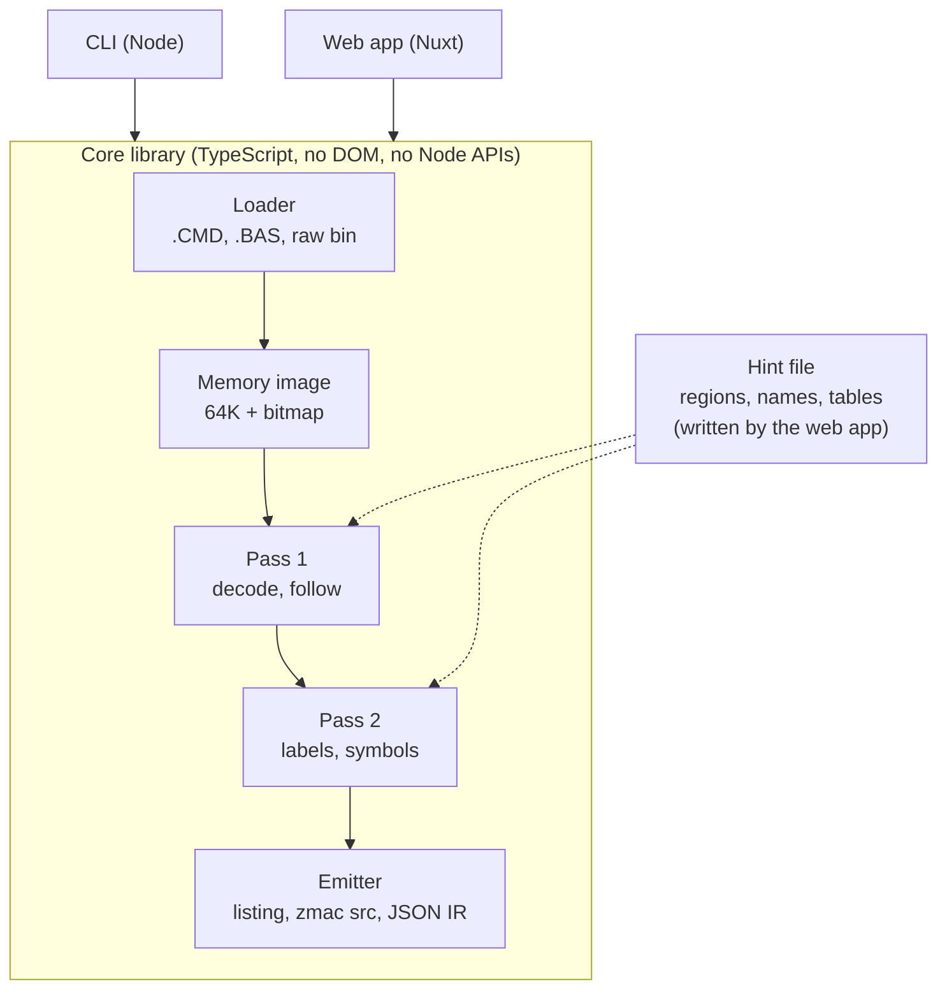
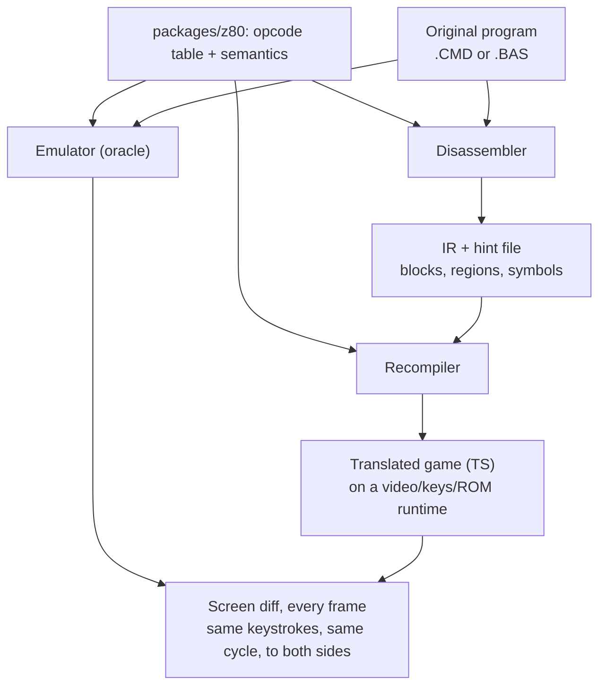

# Fugløy — TRS-80 Disassembler and Recompiler — Project Plan

Oct 14, 2026 · Chris Schweda

> Exported from the living doc at https://claude.ai/code/artifact/d5d7a36e-0c15-429c-a8ed-bee75aee6fde (rev 44, after two adversarial review passes; name and hosting added). Diagrams rendered here as Mermaid.

## Summary

A Z80 disassembler built for the TRS-80 Model I and Model III that reads .CMD load modules and tokenized .BAS programs directly, produces labeled source that reassembles to the same memory image, and runs in the browser as a drag-and-drop workbench. Generic Z80 disassemblers know nothing about TRSDOS, LDOS, or the ROM; this one treats the TRS-80 as the target.

Three things make it worth building:

- **Native .CMD and .BAS input.** Drop a file in; the tool rebuilds the memory image from load records or the BASIC line chain and starts at the entry point. BASIC programs are detokenized, and machine code hidden inside BASIC lines is found and disassembled in place.
- **A labeling pass with TRS-80 knowledge.** ROM entry points, DOS vectors, video and keyboard memory come out named. Jump and call targets get generated labels the user can rename.
- **An interactive listing.** Mark a range as code or data, rename a label, and the listing re-disassembles. A hint file persists every decision.

This document is in two parts. **Part 1 (v1)** is the disassembler and workbench, phases 1–4, fully specified. **Part 2** is the longer-term goal of recompiling programs to TypeScript and shipping them as static bundles; it is outlined here with its decisions recorded, and gets its own design document once phase 3 exists. The appendix holds the measured facts about the sample programs.

## Scope, audience, and rights

**Audience.** One user: the author. The workbench may be deployed publicly because it ships no programs, only a tool. Nothing in v1 depends on other people using it; the sharing and registry ideas in Part 2 are conditional on that changing.

**What v1 is.** Phases 1–4: a core library, a CLI, and a static web workbench for Model I and Model III programs. v1 is done when a real game (asylum16.cmd) produces a listing with named ROM calls that reassembles to the original memory image, and that listing can be annotated and saved in the browser.

**What v1 is not.** Model 4 (banked memory, LS-DOS 6 SVCs), the emulator integration, the recompiler, and the bundler are Part 2. Cassette and disk-image formats are not planned.

**Kill criteria.** If phase 2 cannot produce a round-trip-clean listing of a synthetic fixture within eight weeks of evenings (the estimate's top end plus a third), the approach is wrong and the project pauses for a redesign rather than proceeding to phase 3. Part 2 starts only after phase 3 produces a readable Asylum listing; if phase 4 is still unfinished after the estimate below has doubled, Part 2 is cut and v1 ships as a CLI.

**Rights.** The code is MIT. The programs used as fixtures (Asylum, Volcano Hunter, Voyage of the Valkyrie, Armored Patrol) are still under copyright and are never committed or distributed; tests that use them skip when they are absent. Published ROM address maps are facts and may be used freely; the Model I and III ROM images are Tandy's and stay out of the repo. For Part 2, a TypeScript translation of a copyrighted game is a derivative work, and a runtime that reimplements ROM routines by reading the ROM is derivative of the ROM. Recompiled commercial games are therefore for personal use unless the rights holder agrees; public bundles are limited to public-domain programs (Super Star Trek is one) and the author's own code. Shipping "no original binary" does not change this and the plan does not pretend it does.

## Goals and non-goals

**Goals (v1)**

- Disassemble any Model I or Model III .CMD into zmac-compatible source that reassembles to the identical memory image.
- Detokenize any Level II .BAS into a listing, locate machine code embedded in it, and disassemble that code at its true addresses.
- Name every documented ROM, DOS, and hardware address automatically, with a separate table per machine.
- Let the user correct code/data boundaries and names interactively, with every decision saved to a hint file that survives rebasing.
- Run entirely client-side, with the same core library driving the CLI, the tests, and the browser.

**End state (Part 2)**

- Recompile a program to readable TypeScript and export it as a self-contained static bundle that plays on any static host.

**Non-goals**

- Running code inside the disassembler. v1 is static; execution-trace discovery arrives with the emulator in Part 2.
- Model 4 in v1. The Model 4 SVC table is cheap to add, but banked memory invalidates the single 64K image, so Model 4 is a Part 2 item with its own design.
- Cassette (.CAS), DMK/JV3 images, CoCo, Model 100. Not planned.
- Undocumented opcodes beyond SLL and the IX/IY half registers in v1.

## Landscape

No tool I found does all four of: read .CMD and .BAS natively, carry TRS-80 symbol tables, allow interactive code/data marking, and run in a browser. Each existing option covers part of it; this table reflects what I could verify and should be rechecked before any public claim is made.

| Tool | .CMD / .BAS input | TRS-80 symbols | Interactive marking | Browser |
| --- | --- | --- | --- | --- |
| z80dasm, dz80, zdis | No (raw binary) | No | Block definitions in a control file | No |
| Ghidra (Z80 processor module) | No, but a loader could be written | No, user-supplied | Yes, full IDE | No |
| IDA Pro (Z80) | No | No | Yes, full IDE | No |
| trs80gp debugger (George Phillips) | Runs .CMD; reads zmac symbol files | Via zmac .bds symbols | Breakpoints and a live disassembly view, not a persistent marked listing | No |
| TRSTools (Matthew Reed) | Extracts files from disk images | No | No | No |

The realistic alternative is trs80gp: load the program, open the debugger, read. It is a fine way to look, and it produces nothing you can save, label, or reassemble.

## Architecture

The disassembler is a TypeScript library with no DOM or Node dependencies, so one codebase runs in the CLI, the tests, and the browser.

The pipeline runs left to right. Pass 1 decides what each byte is; Pass 2 decides what to call it; the emitter renders the result as a listing, as zmac source, or as a JSON intermediate representation (IR: typed regions, basic blocks, control-flow edges, symbol table) that the web app and, later, Part 2 consume. The hint file is outside the pipeline and feeds both passes, so an interactive edit is a rerun, not a patch to internal state.

## Input formats

### .CMD load modules

The loader walks the record stream and writes each load block into a 64K `Uint8Array` with a parallel bitmap of loaded bytes. Everything downstream works from the image, never from file order.

| Record | Meaning | Loader action |
| --- | --- | --- |
| `01` | Load block: length, 2-byte address, data | Write at address; mark bitmap; log the block |
| `02` | Transfer address | Save as entry point; stop |
| `03` | End of load, no entry | Stop; mark as not directly executable |
| `05` | Module header (name) | Save for the listing header |
| `1F` | Copyright block | Save; emit as a comment |
| `04`, `06`–`10` | PDS / ISAM / patch records | Parse length, skip, log |

Rules the loader follows, each backed by a sample file in the appendix:

- The `01` length byte counts the two address bytes and wraps: 0 means 254 data bytes, 1 means 255, 2 means 256.
- Blocks may overlap. A later block overwrites an earlier one; the loader logs both extents so the listing can mark the range "patched at load time." **The overwritten bytes are gone from the image and are not recoverable by reassembly.** This is why the round-trip test compares images, not files.
- Blocks may be out of order or non-contiguous. Each run of loaded bytes becomes its own `ORG`.
- Bytes after the `02` record are ignored (tape-conversion debris is common).
- A missing `02` is normal for overlays; the tool falls back to the lowest loaded address and says so.
- Format is detected from content, not extension (`.III`, `.bad`, and `.CMD` are all load modules).
- Raw binaries load at a user-supplied base address.

### .BAS tokenized BASIC

Level II BASIC saved to disk: optional `FF` header, then per line a 2-byte pointer to the next line, a 2-byte line number, the body with keywords as single bytes `80`–`FB`, and a `00` terminator; two zero bytes end the program. The pointers are absolute, so the file records where in memory it was saved from.

This matters because a class of TRS-80 games hides machine code inside BASIC lines so one `CLOAD` fetches both (Voyage of the Valkyrie: 190 of 257 lines are Z80 code, skipped by `GOTO 248`, entered through a `JP` that line 250 pokes into a system vector at run time).

What the .BAS path does:

- Detokenizes to a listing, with `PEEK`/`POKE`/`USR`/`DEFUSR` operands resolved through the symbol table (16548/16549 is the program-start pointer, 16526/16527 the USR vector, 14400 keyboard row 7).
- Finds hidden code by **parse validity**, not byte statistics: a line is BASIC if its body parses as tokens with well-formed operands; a line that fails to parse is treated as data and offered to Pass 1 as a candidate code region. Byte histograms do not work here because `C3`, `CD`, `C9`, `ED`, `DD`, and `FD` are all in the token range.
- Places each hidden region at its true address: line *N*'s body sits at `ptr(N−1) + 4`. Those bytes go into the same 64K image the .CMD loader fills and Pass 1 and Pass 2 run unchanged.
- Mines entry points from the BASIC text: `DEFUSR=`, pokes to the USR vector, and `POKE addr,195` followed by two pokes of an address.
- Offers rebasing, since the saved addresses are an accident of the saving machine's memory map. Hidden code in such programs is usually position-dependent, so a rebased listing shows absolute references pointing at the old addresses; the tool marks those and the listing header states the original base. Hints survive rebasing because they are keyed by block and offset, not address (see Hint file).

## Pass 1: decoding and code discovery

Pass 1 produces a typed map of the image: each byte is code, data of a known kind, or unknown.

**Decoder.** Opcode tables are generated from the Z80's octal structure (x/y/z/p/q decomposition), not typed by hand, covering unprefixed, `CB`, `ED`, `DD`/`FD`, and `DDCB`/`FDCB`. Each instruction records length, mnemonic, operands, cycle count, and control-flow effect (fall through, jump, call, return, halt). The table is a separate package so Part 2 can share it.

**Recursive descent.** From the transfer address and any user entry points, the walker follows every statically resolvable `JP`, `JR`, `CALL`, `DJNZ`, and `RST`, ends a block at `RET`, `JP (HL)`, `JP (IX)`, `JP (IY)`, and unconditional jumps (continuing at the target when known), and queues both arms of conditional branches. Unreached bytes stay unknown.

**Indirect jumps are manual in v1.** `JP (HL)` through a computed table is the standard game-loop dispatch on this machine, and nothing in v1 discovers the table automatically. The hint file lets the user declare a table (base, entry count, entry width) and its entries become roots. Automatic discovery is a Part 2 item, via execution tracing.

**Heuristics for unknown regions**, always overridable:

- Runs of printable ASCII ending in `0DH`, `03H`, or `00H` become strings.
- Consecutive 2-byte values that all land in loaded code are proposed as a jump table, not applied.
- The byte after a `RST 08H` is an inline parameter (the ROM's syntax-check idiom) and is marked data. No other RST takes an inline byte.

**Overrides.** The hint file can force a region to code, bytes, words, or string, add an entry point, declare a jump table, or mark an address never-code. Overrides win.

## Pass 2: labels, symbols, and annotations

Pass 2 never changes what a byte is, only what it is called.

**Label synthesis.** Every jump, call, or data-reference target gets a label whose prefix records the use: `L5210` jump target, `SUB_5340` call target, `DATA_5400` referenced bytes, `TBL_5480` jump table. `LD HL,nnnn` and `LD DE,nnnn` operands inside a loaded region are data references; outside, constants.

**Symbol tables**, one per machine, chosen by the machine selector:

| Table | Contents |
| --- | --- |
| Level II ROM, Model I | Documented entry points (`$0013` keyboard, `$001B` display, `$0033` output char, `$0049` wait key, `$1A19` BASIC ready, and the published list), RAM vectors and system variables in the `$4000` page |
| Level II ROM, Model III | Same documented entry points where Tandy kept them compatible, plus Model III-only routines and RAM differences; entries that differ from the Model I table are tagged so a listing says which machine it assumed |
| Hardware, both | `$3800`–`$38FF` keyboard matrix rows, `$3C00`–`$3FFF` video RAM, cassette and printer ports |
| LDOS 5 / TRSDOS 1.3 (Model I/III) | `@DSPLY`, `@KEY`, `@OPEN`, `@READ`, `@WRITE`, `@CLOSE`, `@EXIT` and the rest of the `$4400`-page vector block |
| LS-DOS 6 (Model 4) | `RST 28H` supervisor calls named from the preceding `LD A,n` (`LD A,10` / `RST 28H` reads as `@DSPLY`). Cheap to include for reading launchers like GO.CMD; full Model 4 support is Part 2 |

Each table is a data file with a source citation per entry. Published maps disagree in places; the citation is how disagreements get settled later.

**User names and comments** come from the hint file and apply everywhere the address is referenced. Known calls get a trailing comment with the routine's purpose. Load-time patches, unreachable code, and overlapping blocks get a comment stating the oddity.

## Hint file

The hint file is the one piece of persistent state in v1. Decisions, made now:

- **Format: line-oriented text**, one directive per line, so it diffs in git and can be hand-edited. Example directives: `code`, `bytes`, `words`, `string`, `entry`, `table <count> <width>`, `name <label>`, `comment <text>`, `nocode`.
- **Keys are block-relative and block identity is content-based**: `block <index>:<offset>` where a block is a loaded run identified by its original start address, its length, and a hash of its first 64 bytes. When a hint file is applied to a different file, blocks are paired by length and hash, not by position, so the same hints apply to Asylum 1b, 1c, and 1d, and a variant with an extra 2-byte vector block (1e) still matches on its main run. Unmatched blocks' hints are reported, not silently dropped.
- **Identity**: the file header carries the SHA-256 of the input program, so the workbench can match a dropped file to its hints and refuse a mismatch.
- **Storage**: a file on disk (CLI) or IndexedDB (browser), downloadable; nothing else in v1.

Part 2 adds annotations for stores that patch code and for interrupt hooks; the format is designed to take new directives without a version bump.

## Web app

A static Nuxt 4 site running the core library in the browser. Files never leave the machine.

1. Drop a .CMD, a .BAS, or a raw binary (with a base address). The header shows blocks, entry point, program name, and the detected machine.
2. The listing renders with recursive descent from the entry point and the selected machine's symbol table.
3. Select a range and press a key to mark it code, bytes, words, or string; declare a jump table from a selection. The listing re-disassembles.
4. Click a label to rename it; click the comment column to annotate. Every edit updates the hint file.
5. Export the zmac source, the hint file, or the JSON IR.

**Listing:** address, bytes, label, mnemonic and operands, comment. Known addresses are links to a side panel with the ROM/DOS description and cross-references. A 20K program is roughly 8,000 listing rows, so the listing is virtualized from day one; this is the main technical risk of phase 4 and is prototyped first.

**Machine selector:** Model I, Model III, or "Model 4 (symbols only)", the last of which enables SVC naming for reading launchers without claiming to understand banked memory. Full Model 4 support arrives with Part 2. The selector changes the symbol table only.

## Testing

- **Opcode exhaustion.** Generate every encoding across all prefixes, decode, and compare to a published reference table checked into the repo.
- **Synthetic .CMD fixtures.** A .CMD writer in the test suite builds files for every loader rule above: 254/255/256-byte blocks, out-of-order and overlapping blocks, `05` and `1F` records, no `02`, trailing bytes, every PDS/ISAM type.
- **Synthetic .BAS fixtures.** A tokenizer in the test suite builds BASIC programs with and without embedded code, saved from two different base addresses, to test detokenizing, hidden-code detection, address placement, and hint portability.
- **Image round trip.** Disassemble a fixture, assemble the output with a pinned zmac, load the result, and compare the two **memory images and bitmaps**. This catches label, `ORG`, and operand-encoding mistakes. It does not and cannot compare files.
- **ROM smoke test.** When a ROM image is present locally, disassemble it and assert the documented entry points decode as code and that descent reaches a minimum fraction of the image. Skipped otherwise.
- **Real-program snapshots.** A gitignored `sample/` holds the sample programs; expected-output snapshots are committed; tests run when the files are present and skip when not.
- **Web app.** Component tests for marking and renaming; one Playwright test that drops a fixture, marks a region, exports, and checks the hint file; a render test that scrolls an 8,000-row listing.

## Phases and estimates

Estimates are in evenings-and-weekends calendar time and assume one person. They are deliberately pessimistic; the earlier draft's "a few evenings" was not an estimate.

1. **Core decoder and loaders.** Generated tables, exhaustion test, .CMD and .BAS loaders, detokenizer, memory image, and the two synthetic fixture writers (a .CMD record writer and a BASIC tokenizer) the tests depend on. Deliverable: a CLI that prints a linear-sweep listing of any .CMD and a detokenized listing of any .BAS. **2–3 weeks.**
2. **Pass 1 and Pass 2.** Recursive descent, string heuristic, jump-table proposal, hidden-code detection, label synthesis, hint-file reader/writer, zmac emitter, image round-trip test. Deliverable: every synthetic fixture round-trips; Valkyrie's hidden code disassembles at the right addresses. **4–6 weeks.** Kill criterion applies here.
3. **Symbol tables.** Model I and Model III ROM tables (two maps entered and compared, not one), hardware table, LDOS 5/TRSDOS 1.3 vectors, LS-DOS 6 SVC names, machine selector, per-entry citations; verify the Landscape table's claims about other tools before any public README repeats them. Deliverable: Asylum and Volcano Hunter listings with named ROM and DOS calls. **3–4 weeks for the first hundred entries of each ROM map plus the DOS vectors; the tables keep growing afterward.**
4. **Web workbench.** Virtualized listing first, then drop zone, marking, renaming, side panel, export, IndexedDB persistence; Netlify deploy. Deliverable: the v1 done-criterion above. **6–8 weeks.**

Total v1: roughly four to five months of spare time. Part 2 is not estimated until phase 3 is done, because its first step (emulator integration) depends on how the emulator's CPU core takes to the shared opcode table.

## Risks and open questions

**Risks**

- Code/data separation needs a human in v1. Heuristics propose; the user decides. Mitigation: make marking fast, and get execution tracing early in Part 2.
- Opcode-table errors are silent. Mitigation: generated tables and the exhaustion test on every commit.
- Symbol sources disagree. Mitigation: one data file per table, a citation per entry.
- zmac drift. Mitigation: pinned version in CI.
- Listing performance in Vue. Mitigation: virtualize first, prototype before building the rest of phase 4.
- Scope creep toward Part 2. Mitigation: the kill criteria and the rule that Part 2 gets its own document.

**Open questions**

- ~~Which undocumented opcodes to emit and how to spell them (zmac's names or Zilog's).~~ Decided in phase 2: only `SLL` and the IX/IY half registers (`IXH`, `IXL`, `IYH`, `IYL`) are emitted as instructions, spelled as zmac accepts them, which is also how the listing spells them; every other undocumented encoding is emitted as `DB`. The pinned zmac assembles all 1786 non-prefix encodings back to their own bytes except the redundant `ED 63`/`ED 6B` forms of `LD (nn),HL`/`LD HL,(nn)`, which it shortens and which are therefore emitted as `DB`.
- Whether multi-file programs need a session with several images in v1, or whether annotating `@LOAD`/`@RUN` calls with their filename string is enough until Part 2. Current lean: annotate only.

## Stack

- **Core:** TypeScript, zero runtime dependencies, ESM only, built with `tsc` project references (tsup was dropped during phase 1: TypeScript 7's native compiler has no JS API for tsup's `.d.ts` plugin, and a dependency-free ESM library needs no bundler). MIT.
- **CLI:** Node, thin wrapper over the core.
- **Web:** Nuxt 4 with Nuxt UI, pnpm, static generation, no server routes. Netlify.
- **Tests:** Vitest; Playwright for the browser flow; zmac installed in CI. GitHub Actions.
- **Repo:** pnpm monorepo. v1 creates `packages/z80` (table and semantics), `packages/disasm` (loaders, passes, IR, emitters), `packages/cli`, `apps/web`, `fixtures/synthetic`. Part 2 adds `packages/emulator`, `packages/recomp`, `packages/runtime`. ROM images and real programs live outside the repo.

**Name and hosting.** The project is **Fugløy** (the island in Voyage of the Valkyrie; spelled `fugloy` in code, repo, and package names). Domain `fugloy.dev`, registered at DNSimple, DNS left at DNSimple with ALIAS for the apex. Layout: `app.fugloy.dev` is the workbench and the primary domain of its Netlify site; `fugloy.dev` and `www.fugloy.dev` are aliases that 301 to it until a landing page exists, at which point the apex moves to its own site. Each exported game (Part 2) gets `<slug>.fugloy.dev`, served either as its own Netlify site or by host-based rewrites from one games site; slugs come from the manifest, are lowercase-hyphenated, and are checked against a reserved list (`app`, `www`, `api`, `docs`, `cdn`, `play`). Because `.dev` is HSTS-preloaded, every hostname is HTTPS-only and redirects are done by Netlify, not by DNS-level URL records. Commercial-game subdomains are password-protected by default (Netlify site password), driven by the manifest's `rights` field; only public-domain titles and the author's own programs are open. Package scope: `@fugloy/*`.

## Part 2: recompilation (outline)

The long-term goal is to turn a TRS-80 game into readable TypeScript that plays identically in a browser, shipped as a static bundle. This section records the shape and the decisions so v1 does not close doors; the detail belongs in a second design document written after phase 3.

**What "identical" means.** Identical to a specific machine, named per game in its manifest: Model III at 2.03 MHz for Model III programs, Model I at 1.77 MHz for Model I programs. The emulator is Model III today, so Model I programs are verified under Model III until a Model I mode exists, and the manifest records that caveat.

**What it is and is not.** The game's own logic becomes source: readable functions named by Pass 2's labels, no Z80 instructions decoded at run time. The machine around it is simulated in a hand-written runtime: video RAM at `$3C00` on a canvas, the keyboard matrix at `$3800`, the ROM routines the game calls, cassette-port sound, the 30 Hz heartbeat and its `$4012` hook, and cycle pacing. That is the hardware half of an emulator without the instruction interpreter; the N64 recompilation projects have the same shape.

**Decisions already made.**

- Output: TypeScript, not WebAssembly. Speed is irrelevant at 2 MHz; readability is the point.
- Flags: computed eagerly, every instruction, in plain code. Lazy flags would make the output unreadable for a speed gain nobody needs.
- Scheduling: the translated game runs in a Web Worker as ordinary functions; it posts the 1K screen to the main thread each frame. No generators, no `yield*` on every call.
- Interrupts: every basic block ends with a cycle-count update and a check for a pending heartbeat; the runtime raises it every 1/30 s of emulated time.
- Indirect jumps: translated when the target set is known (from a hint-file table or an execution trace); otherwise a `switch` on the address for that site, which is a small interpreter and is labeled as such in the output.
- Self-modifying code: not translatable statically. Each instance (GO.CMD's patched `JP`, Asylum's load-time patches, Valkyrie's runtime vector poke) is either annotated in the hint file as a jump with a known target set or left to an interpreter fallback for that region.
- First target: a ten-instruction synthetic program, then a small public-domain utility, then a game. Not Volcano Hunter first; nothing about it is simple.

**Steps, in order.**

1. **Emulator harness and execution tracing.** Add `load`, `step(cycles)`, `readMemory`, `registers`, `pressKey`, a screen hash, and a PC/write trace to the author's trs80-emulator; move its CPU core onto `packages/z80`; validate the core with a Z80 instruction exerciser (ZEXALL needs a CP/M shim or a Model 4 CP/M image, which is work, not a command). Tracing feeds the hint file: visited bytes are code, writes into code are self-modification, jump targets are tables. This is the first Part 2 step because it improves v1 listings before any recompiler exists. Risk: the emulator has a working core with 536 tests, and rewiring it onto a new table can break it in quiet ways. Fallback if it does: share only the decode table (lengths, operands, cycle counts) and keep each consumer's own execution semantics, with a cross-check test that runs the exerciser against both.
2. **Model 4.** Banked memory via port `$84`, LS-DOS 6, SVCs. Needed for launcher-style programs; also where the emulator becomes useful to other people.
3. **Recompiler and runtime.** IR to TypeScript; the runtime; the oracle test: the same keystroke script, delivered at the same emulated cycle, to the original in the emulator and to the translation, comparing video RAM at a fixed point in each frame (vertical blank) and with `RND` seeds and the clock pinned on both sides. The first divergence names the wrong block. Keep trsjs (Peter Phillips, derived from trs80gp) as a tiebreaker when the two emulators disagree.
4. **Bundler.** A per-game manifest (name, author, year, machine, files, hint file, rights status) drives a build that emits one HTML file or an ES module with a `<trs80-game>` element, with the runtime inside and no original binary or ROM image. Public bundles only for programs whose rights allow it.
5. **Runtime features**, in the shared runtime so every game gets them: an accessible text mirror of the screen (updated on change, throttled, with row-level semantics, so it is usable rather than a firehose), save states, key remapping, touch controls, screenshot export.

**Deferred ideas, unscheduled:** edit-reassemble-run in the workbench using the author's Z80 assembler; relocation-aware diff of two builds; string extraction and reimport; a hint registry keyed by program hash (git folders first; a hosted store such as Supabase only if annotations are ever shared); rendering data regions as a TRS-80 screen or as block graphics.

## Appendix: sample-program findings

Measured with a throwaway record parser during planning. These are the expected values for the real-program snapshot tests.

| File | Load ranges | Entry | What it shows |
| --- | --- | --- | --- |
| asylum1a.cmd | 6000–9D66 | 9D1C | Earlier, smaller build (15.7K) |
| asylum1b/1c/1d.cmd | 6300–B248 / A000–EF48 / 5200–A148 | B112 / EE12 / A012 | Same 20,297 bytes relocated three ways; relocation test; tape-conversion text and trailing bytes (823 in 1b) |
| asylum1e.cmd | 5200–A020, 4016–4017 | A012 | Module name record; 2-byte DOS-vector poke at $4016 |
| asylum1f.cmd | 6100–ADA6 | AD92 | Different build (19.6K) with embedded `DEFB` source fragments |
| asylum16 / asylum32.cmd | 8000–BFEF / 8000–CE20 (+4016) | 8000 / CE12 | 16K and 32K versions |
| asylum1g.cmd | 62F3–B13A, 3C00–3FFF | B117 | Title screen loaded straight into video RAM |
| asylumd.bad | 8000–CE20 with patches at 9267–9269 and B01C–B01E, plus D000–D114 | CE12 | asylum32 plus a disk save/load routine; the overlap-and-patch fixture |
| volcano.cmd | 3C00–4005, 52E9–9142 | 9134 | Volcano Hunter (David A. Smith, 1984); title block overruns video RAM by 6 bytes into $4000 |
| GO.CMD | F000–F0BD (190 bytes) | F000 | Generic Model 4 LS-DOS launcher: @FSPEC 78, @FEXT 79, @LOAD 76, @ERROR 26; `OUT (84H)` map switches; rebuilds Model III ROM vectors in the `$4000` page; patches its own `JP` operand at F0B9 with the loaded transfer address |
| ARMOUR.III | 8000–B8FF, patch at B801–B80F | B801 | Armored Patrol payload for GO; a plain .CMD under another extension; the patch overwrites the entry point |
| valkyr*.bas (14 files) | BASIC start $62C8–$6F00 depending on file | `GOTO 248` | Voyage of the Valkyrie (Leo Christopherson, 1980); 190 of 257 lines are Z80 code; line 250 computes the code address from `PEEK(16548/16549)+14` and plants a `JP` with `POKE ...,195`; several files are saved games (`C$` differs) |

Level II BASIC tokens, bytes `80`–`FB` in order: END FOR RESET SET CLS CMD RANDOM NEXT DATA INPUT DIM READ LET GOTO RUN IF RESTORE GOSUB RETURN REM STOP ELSE TRON TROFF DEFSTR DEFINT DEFSNG DEFDBL LINE EDIT ERROR RESUME OUT ON OPEN FIELD GET PUT CLOSE LOAD MERGE NAME KILL LSET RSET SAVE SYSTEM LPRINT DEF POKE PRINT CONT LIST LLIST DELETE AUTO CLEAR CLOAD CSAVE NEW TAB( TO FN USING VARPTR USR ERL ERR STRING$ INSTR POINT TIME$ MEM INKEY$ THEN NOT STEP + - * / ^ AND OR > = < SGN INT ABS FRE INP POS SQR RND LOG EXP COS SIN TAN ATN PEEK CVI CVS CVD EOF LOC LOF MKI$ MKS$ MKD$ CINT CSNG CDBL FIX LEN STR$ VAL ASC CHR$ LEFT$ RIGHT$ MID$ '
